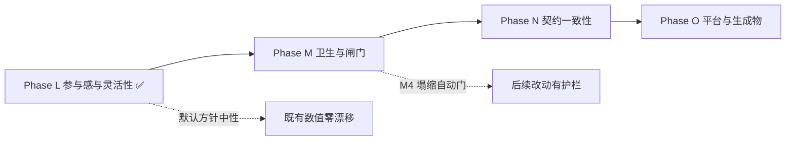

# world1980 · 项目评审与后续迭代路线

> 评审日期：2026-10-17（Phase L 交付于 2026-10-18）｜ 基线提交：`0e82a70` → Phase L 之后
>
> **基线全绿**：`validate_data` ✅ · `validate.test` 65/65 ✅ · 探针 25/25 ✅ · `cmp` identical:25 ✅
> **断言总数**：664 条命名断言 + 39 条诊断（Phase L 前为 614 + 23）

---

## 一、结论摘要

项目已处于历史最佳状态。四道护栏（数据契约 / 效果词表 / 存档迁移 / 跨平台探针）齐备，
七大国全部跑通「外部压力 → 内政天平 → 议程门控 → 完成回馈」的闭环，
产物体积已定为「不再优化」的回归护栏（磁盘 `out/` ≤ 3.2 MiB）。

本轮评审分两步：先找出「哪些结构债会在下一次加功能时反噬」（9 条发现），
再针对**参与感与战略灵活性**做了第一轮玩法迭代（Phase L，已交付）。

### 9 条发现（全部来自实测）

- **结构债**（2 条）：纯搬运即可消除，验收标准是 `cmp` 仍 identical；
- **流程债**（2 条）：不同步就静默失效，靠自动门消除；
- **契约债**（3 条）：真正改代码路径或已成死代码，必须逐位核对；
- **生成物与平台债**（2 条）：手写维护的生成物 + PWA 深链取舍。

### Phase L 一句话结论

此前**七大国各有 2 个零代价、可无限点击的内政动作**，而**47/54 个实体一个按钮都没有** ——
"选择"形同虚设。Phase L 用「政治资本（稀缺行动预算）+ 施政方针（自选治理路线）」
把已有系统变成真正的取舍，并让全部 54 个可玩实体都能施政。
**默认方针完全中性，因此 24 个非 domestic 探针逐位不变。**

---

## 二、已交付阶段回顾（A–L）

| 阶段 | 主题 | 关键成果 |
| --- | --- | --- |
| **B** | 架构 | 9108 行单 IIFE → 13 个有序模块；rAF 播放态调度 + 单一 resize 监听 |
| **C** | 存档 | 失败诊断 `{ok,reason,detail}` + 4 槽位 + 导入导出 + 版本迁移表 |
| **D** | 数据层 | `GRD` 悬空修复、`INIT_RESERVES` 30→54、构建期外键 + 效果词表校验、统一 `resolve()` |
| **E** | 玩法 | AI 反应式 → 主动战略目标（22 目标 / 9 国）、CHN/DEU 专属内政、沙盒模式 |
| **F** | 快赢 | 探针接 CI（跨平台运行器 + 基线 + 双 job 绿）；修复 blocprobe/decprobe 两个长期失效探针 |
| **G** | 收尾 | `12-probes.js`（1754 行）→ `app/probes/*` 9 个模块；超长函数清零；调试面收敛为单一 `window.__W1980` |
| **H** | 玩法深度 | AI 目标权重平滑化；CHN/DEU 内政↔经济双向耦合；CHN/DEU 三步议程树 + 内政门控 |
| **I** | 工具链 | 校验器拆成可单测模块 + `--json`/`--report`；效果词表运行期双保险；54 实体覆盖矩阵 |
| **J** | 平台化 | 存档 v2→v3 迁移链；GitHub Pages + PWA（预缓存 87 项）；产物 3.516 → 3.127 MiB |
| **K** | 玩法深度 | JPN/FRA/GBR 专属内政 + 三步议程树；门控统一为数据声明式 `domestic_faction`；删 `has_capital`（−59,827 B） |
| **L** | 参与感与灵活性 | 政治资本行动预算（月度结算、动作扣费、不足即拒绝且零副作用）；47 个通用实体获得 3 条施政路线；施政方针三选一（均衡/强硬/改革）改变成本与漂移；面板预算条 + 成本角标 + 禁用态 |

### 当前玩法骨架（七大国全覆盖）

| 国家 | 内政天平 | 外部压力来源 | 议程树 |
| --- | --- | --- | --- |
| SUN | 保守鹰派 vs 改革派 | 军费 / 商品短缺 | 合资法 → 新联盟 |
| USA | 国会 vs 总统民调 | 赤字 / 预算帽 | 供给学派 → SDI |
| CHN | 计划派 vs 特区派 | 制裁 / 巴统 / 能源缺口 | 特区 → 裁军 → 市场化 |
| DEU | SPD vs CDU | 油气通道 / 巴统 / 制裁 | 新东方 → 单一市场 → 防务支柱 |
| JPN | 出口产业派 vs 内需开放派 | 技术出口通道 / 原油矿产 / 巴统 | 半导体 → 黑潮 → 前川报告 |
| FRA | 国家干预派 vs 紧缩坚挺派 | 油气输入 / 巴统 / 资本外逃 | 国有化 → 紧缩转向 → 工业重组 |
| GBR | 货币主义派 vs 福利共识派 | 巴统 / 制裁 / 全球金融风险溢价 | 货币主义 → 工会改革 → 大众持股 |

### 玩家可用的战略杠杆（Phase L 之后）

| 杠杆 | 作用 | 代价 / 约束 |
| --- | --- | --- |
| 军费占比滑块 | 直接改写国防投入与阵营网络加成 | 挤压民生、抬高对手张力 |
| 制裁 / 军援（各 2 个目标 × 3 档） | 改写目标国经济与自身反噬 | 逐档自损 |
| 内政施政动作（大国 2 条、通用实体 3 条） | 推动派系天平与关键指标 | **消耗政治资本**（12–20 点/次） |
| 施政方针（均衡 / 强硬 / 改革） | 改变动作成本、动荡漂移、预算结算速率 | 切换 15 点；非均衡路线自带副作用 |
| 国家战略指令（6 选 2，24–36 个月） | 跨年度目标：达标返还预算并记入编年史 | 采纳 10 点；逾期扣预算并抬升动荡 |
| 专属议程（各国 2–3 步树） | 结构性 GDP / 外汇 / 安定加成 | 前置链 + 内政门控 |
| 首脑峰会 / 军控条约 / 安理会决议 | 改写美苏张力与地区秩序 | 需满足可行性与票数 |
| 隐蔽行动 / 阿富汗政策 | 情报、代理人战争与帝国失血 | 暴露风险与资源消耗 |
| 危机抉择卡 | 一次性高风险高回报 | 选项互斥，效果不可逆 |

---

## 三、评审发现

> 每条都附实测证据。按**性质**分类，不按主观优先级 —— 「结构债」的验收标准是 `cmp` 仍 identical（纯搬运），
> 「契约债」才会真正改变代码路径，必须逐位核对。

### A. 结构债（纯搬运，验收 = `cmp` identical:25）

| # | 发现 | 实测证据 | 对策 |
| --- | --- | --- | --- |
| **S-1** | `07-domestic.js` 膨胀到 **2451 行**，domestic / agenda / crisis 三区规模相当；下一个议程树会把它推过 2600 行 | 逐行定位函数声明：domestic **29 fn / 1224 行**（第 5–1228），agenda **15 fn / 886 行**（1229–2114），crisis **8 fn / 337 行**（2115–2451） | **L1** crisis 区整段搬到 `app/07a-crisis.js` |
| **S-2** | **函数归属错乱**：① `07-domestic.js` 第 5/37 行的 `refreshLeaderCard` / `refreshOverviewCard` 是**领袖肖像卡与概览卡**（UI），却被 `06-ai.js:906/912`、`11-shell.js:870`、`08-covert.js:1017/1019` 调用；② `08-covert.js`（1074 行）同时承载 **5 个子系统**：intel（5 fn）、afghan（5 fn）、sound（3 fn）、assets probe（1 fn）、panel tabs（1 fn） | `Select-String` 确认四个调用点；`08-covert.js` 函数清单确认五组互不相关的函数 | **L1** 一并搬运：两个 UI 函数移到 `11-shell.js`，sound/assets 探针移到 `probes/` |

### B. 流程债（不同步就静默失效）

| # | 发现 | 实测证据 | 对策 |
| --- | --- | --- | --- |
| **S-3** | 新增探针要同步 **4 处**（`probe_runner.py PROBES`、`13-boot.js` 25 个 `if`、`CR.probeMode` 正则、`09-debug-hook.js`），**不同步就静默失效** —— 历史上 blocprobe/decprobe 就是这么死的 | 探针 URL 参数在 runner 与 `probeMode` 正则里逐字重复；`endprobe` 用 `end=1` 而非 `endprobe=1`，已是不一致先例 | **L2** `PROBE_PARAMS` 常量 + runner 自检 diff |
| **S-4** | 「断言塌缩」检测只在 `cmp` 一层，**全靠人工核对** | 25 个探针共 **637 条命名断言** + 195 个扁平字段；**16 个断言名跨探针重复**（`spectatorZeroPmods` 出现在 6 个探针） | **L4** `probe_runner.py count` + `cmp` 在断言数减少时判失败 |

### C. 契约债（真正改代码路径，需逐位核对）

| # | 发现 | 实测证据 | 对策 |
| --- | --- | --- | --- |
| **S-5** | **议程完成回馈是逐国 if-else**（加一国就要改引擎），且 `effects.js` 的 target 注释已与实现不同步（`stabilityBonus` 仍写 `generals[*].stability`，但七大国已走专属分支） | `updateMonthlyAgendas` 中 `stabilityBonus` 分派为 SUN/USA/CHN/DEU/JPN/FRA/GBR/generals **八路** | **M1** 改为数据声明式 `ag.onComplete` |
| **S-6** | 引擎里 `domestic_reform_lead` / `domestic_detente` 两个 handler 在数据侧**零引用**（Phase K 已把 CHN/DEU 改写成 `domestic_faction`），已成死代码；而「数据用了未注册 condition」目前不会让 CI 失败 | 数据侧 condition 全集 = `{mil_le_1, mil_le_3, mil_ge_5, domestic_faction}` | **L3** 删两个 handler + 「未知 condition 判 CI 失败」 |
| **S-7** | **备份仓 pipeline 与主仓 `out/` 双写**，靠 `robocopy /MIR` 手工同步 | Phase K 需在两侧各改一次 `has_capital`；镜像后 `git status` 出现 8 个待提交文件 | **M2** 二选一：pipeline 为唯一事实源 / 备份仓 CI 加 diff 门 |

### D. 生成物与平台债

| # | 发现 | 实测证据 | 对策 |
| --- | --- | --- | --- |
| **S-8** | `sw.js` 的 `PRECACHE` **87 项手写**维护；而 README 已声称「这两个文件由 `out/` 的文件清单生成」——**实际上仓库里没有任何生成器** | `Select-String` 全仓（排除 `out/`）搜 `PRECACHE`/`precache`/`sw.js` → **0 命中**，即无生成脚本 | **N2** `tools/sw_manifest.js` 自动生成 + CI diff 校验（顺带修正 README 的表述） |
| **S-9** | PWA 在带参深链下**静默失效**（`?player=SUN` 丢掉离线能力，且无提示） | `14-pwa.js`：`bare = q === "" \|\| q === "?"`，带任何参数即不注册 | **N1** 改用 `PROBE_PARAMS` 反向匹配 |

---

## 四、后续路线（Phase L–O）

### Phase L — 参与感与战略灵活性（✅ 已交付）

> 目标：让「选择」真的成为选择。此前七大国各有 2 个内政动作且**零代价、可无限点击**，
> 47/54 个实体（所有非大国）面板里**一个可点的按钮都没有** —— 这是可玩性与参与感的最大缺口。
> 本轮不新增数值系统，而是给已有系统加一层「稀缺性 + 自主路线」。
> **对既有仿真数值零影响**：预算与方针只约束玩家动作，不写 `P.pmods`；默认方针完全中性。

| 项 | 内容 | 验收标准（已达成） |
| --- | --- | --- |
| **L1 政治资本** | 玩家专属行动预算：每月按「执政合法性 / 社会动荡」结算（基准 +3.0，区间 [-1.5, +6.0]），上限 100。合法性取自各国最能代表施政授权的指标（SUN 用政治局天平撕裂度+短缺、USA 用国会支持率、CHN 用改革派差值+双轨物价、DEU 用缓和深度+能源压力、JPN 用贸易摩擦、FRA 用法郎平价+外部压力、GBR 用金融城+通胀、通用实体用合法性） | 19 条断言：结构/结算方向/夹取/月度推进/扣费精确性/**不足时零副作用**/成本表/存档往返/旧档缺省 |
| **L2 通用施政** | 47 个此前零按钮的实体获得 3 条互斥路线：财政紧缩（合法性↑民生↓动荡↑）、扩大福利（安定↑动荡↓合法性↓）、强化治安（动荡↓↓合法性↓↓）。全部消耗同一份政治资本 | 面板渲染 3 按钮 + 三条路线各自的代价方向断言 |
| **L3 施政方针** | 玩家自选治理路线：⚖️ 均衡（默认，零漂移零折扣）/ 🛡️ 强硬（压制动荡、强硬类动作 -20~30% 成本，但结算 -0.8/月）/ 🌱 改革（开放福利类动作 -15~20% 成本、结算 +1.0/月，但每月抬升动荡）。切换消耗 15 点 | 16 条断言：默认中性/切换扣费/不足拒绝/重复选择无操作/两侧成本折扣/结算方向/**动荡漂移差分比较**/面板高亮/存档往返 |
| **L4 UI** | 执政国面板顶部统一插入政治资本预算条（含月度结算率）、动作按钮成本角标 `-N`、预算不足时按钮禁用且后端同样拒绝；方针三按钮带高亮与说明 | CDP 真浏览器 9 步检查全 PASS（含点击真实按钮、禁用态、差分漂移、指令板、存档往返、确定性） |
| **L5 战略指令** | 玩家自选**长周期目标**（6 选 2）：社会和解 / 民意授权 / 储备积累 / 战略落地 / 军费收缩 / 军备扩张。采纳消耗 10 点，达标返还 18–25 点并记入编年史，逾期未达标则扣预算并抬升动荡。指标全部读既有状态（动荡/合法性/军费/外汇/议程数），不新增任何经济通道 | 15 条断言：初始为空/旧档缺省/采纳扣费/重复拒绝/上限 2 项/预算不足拒绝/进度计算/达标返还/已完成不可再采纳/逾期惩罚/面板渲染/存档往返 |

**关键设计约束（务必保持）**：默认方针 `balanced` 的 `costMod = {}`、`unrestDrift = 0`、`capitalMod = 0`，
因此 AI 与史实路径完全不受影响 —— 这也是本轮 24 个非 domestic 探针逐位不变的根因。

### Phase M — 卫生与闸门（低风险，0.5–1 天）

> 全部**不改变任何仿真数值**，是后续所有改动的干净地基。
> 对应发现：M1→S-1/S-2 · M2→S-3 · M3→S-6 · M4→S-4

| 项 | 内容 | 验收标准 |
| --- | --- | --- |
| **M1** | 三处纯搬运：① `07-domestic.js` 的 crisis 区 → `app/07a-crisis.js`；② `refreshLeaderCard` / `refreshOverviewCard` → `11-shell.js`；③ `08-covert.js` 的 sound / assets 探针 → `probes/`。`index.html` 脚本顺序同步 | **`cmp` 仍 identical:25**（纯搬运的最终判据）；`07-domestic.js` < 1500 行、`08-covert.js` < 850 行（均按物理行计；Phase L 已让 `07-domestic.js` 增至 2660 行，拆分更紧迫） |
| **M2** | 探针注册收敛：`13-boot.js` 导出 `PROBE_PARAMS` 常量数组，`CR.probeMode` 改为 `some()`；runner 增加「PROBES 键 vs PROBE_PARAMS」自检 | 新增/改名探针只改一处；两者不同步时 runner 报错 |
| **M3** | 清死代码：删引擎里数据侧零引用的 `domestic_reform_lead` / `domestic_detente` 两个 handler；`validate_data.js` 增「未知 condition 判失败」 | 基线 identical；故意写一个未注册 condition 必须让 CI 失败 |
| **M4** | 断言塌缩自动门：`probe_runner.py count` 输出每探针断言数，`cmp` 在断言数**减少**时判失败（增加不算失败） | 删掉一条断言 → `cmp` 必须退出非 0。**本轮断言数已从 614 增至 649，正是需要这道门的时候** |

### Phase N — 契约一致性（中风险，1 天）

> 对应发现：N1→S-5 · N2→S-7

| 项 | 内容 | 验收标准 |
| --- | --- | --- |
| **N1** | 议程完成回馈数据声明式：`ag.onComplete` 描述内政变量增量，引擎统一求值，删除 8 路 if-else；同步修正 `effects.js` 的 target 注释 | 五条 `*CompletionFeedsDomestic` 断言全绿；基线差异只落在预期字段 |
| **N2** | 备份仓 pipeline 双写收敛：pipeline 为唯一事实源（主仓 `out/` 由它组装）**或** 备份仓 CI 加「pipeline 输出 == out/」diff 门 | 重跑 pipeline 后 `git status` 干净 |

### Phase O — 平台与生成物（低风险，0.5 天）

> 对应发现：O1→S-9 · O2→S-8

| 项 | 内容 | 验收标准 |
| --- | --- | --- |
| **O1** | PWA 深链注册修复：判定从「查询串为空」改为「不含探针参数」 | `?player=SUN` 下 `navigator.serviceWorker.controller` 非空；探针下仍不注册 |
| **O2** | `sw.js` 预缓存清单自动生成：`tools/sw_manifest.js` 扫 `out/` 写 `PRECACHE`，CI diff 校验；修正 README 中「已自动生成」的表述 | 新增静态文件后不更新 `sw.js` → CI 失败 |

### 执行顺序的理由



- **L 已完成**：新增了玩家行动预算与治理路线，`07-domestic.js` 随之变长，因此 M1 的拆分从「建议」升级为「应尽快做」。
- **M 必须早做**：M1 拆文件让后续改动有干净边界，M4 的塌缩自动门保护已增至 649 条的断言集。
- **N 改引擎**：N1 真正改 `updateMonthlyAgendas` 的分派逻辑，必须在 M 的护栏之后。
- **O 可穿插**：纯平台层，风险最低。

---

## 五、约束与不变量（改动前必读）

1. **仿真确定性（最高优先级）**：不得改变 1980–1991 史实路径的逐位数值。改动后重生成 `tools/baseline-probes.json`，确认除时间/画布/平台字段外逐位一致。
2. **存档格式**：`SAVE_VERSION = 3`。结构变更必须走 `SAVE_MIGRATIONS`；新增字段走 `sanitize*` 默认值即可不升版（Phase H/K 已验证）。
3. **效果词表**：新增 `effects` 键必须先进 `data/effects.js`，否则构建期判失败。
4. **探针即契约**：`tools/baseline-probes.json` 是回归基线；差异必须能逐条解释，**绝不能丢失断言**。
5. **发布**：任何发布文件变更都要 bump `out/sw.js` 的 `CACHE_VERSION`。

### 每次改动后的固定动作

```bash
node tools/validate_data.js out
node tools/validate.test.js
python tools/probe_runner.py run out tools/probe-results.json
python tools/probe_runner.py cmp tools/baseline-probes.json tools/probe-results.json
```

四项全绿后再提交；重生成基线前先看清差异。
