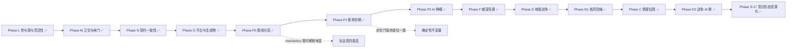

# world1980 · 项目评审与后续迭代路线

> 评审日期：2026-10-17（Phase L 交付于 2026-10-18；M/N/O 交付于 2026-10-19；P0/P1/P2 与 F 交付于 2026-10-19）｜ 基线提交：`0e82a70` 之后连续推进
>
> **基线全绿**：`validate_data` ✅ · `validate.test` 179/179 ✅ · 探针 33/33 ✅ · `cmp` identical:33 ✅
> **断言总数**：1274（`probe_runner.py count` 口径，含扁平探针观测）
> **探针分类**：`cmp --class=history`（3 个，史实轨迹）是 CI **硬门**，必须逐位一致；
> 全量 `cmp` 只报告差异，不阻塞 —— `mechanics` 类的差异必须逐条写进提交信息。

---

## 一、结论摘要

项目已处于历史最佳状态。四道护栏（数据契约 / 效果词表 / 存档迁移 / 跨平台探针）齐备，
七大国全部跑通「外部压力 → 内政天平 → 议程门控 → 完成回馈」的闭环，
产物体积已定为「不再优化」的回归护栏（磁盘 `out/` ≤ 3.2 MiB）。

本轮评审分两步：先找出「哪些结构债会在下一次加功能时反噬」（9 条发现），
再针对**参与感与战略灵活性**做了第一轮玩法迭代（Phase L，已交付）。

### 9 条发现（全部来自实测）

- **结构债**（2 条）：纯搬运即可消除，验收标准是 `cmp` 仍 identical；
- **流程债**（2 条）：不同步就静默失效，靠自动门消除；
- **契约债**（3 条）：真正改代码路径或已成死代码，必须逐位核对；
- **生成物与平台债**（2 条）：手写维护的生成物 + PWA 深链取舍。

### Phase L 一句话结论

此前**七大国各有 2 个零代价、可无限点击的内政动作**，而**47/54 个实体一个按钮都没有** ——
"选择"形同虚设。Phase L 用「政治资本（稀缺行动预算）+ 施政方针（自选治理路线）」
把已有系统变成真正的取舍，并让全部 54 个可玩实体都能施政。
**默认方针完全中性，因此 24 个非 domestic 探针逐位不变。**

---

## 二、已交付阶段回顾（A–M）

| 阶段 | 主题 | 关键成果 |
| --- | --- | --- |
| **B** | 架构 | 9108 行单 IIFE → 13 个有序模块；rAF 播放态调度 + 单一 resize 监听 |
| **C** | 存档 | 失败诊断 `{ok,reason,detail}` + 4 槽位 + 导入导出 + 版本迁移表 |
| **D** | 数据层 | `GRD` 悬空修复、`INIT_RESERVES` 30→54、构建期外键 + 效果词表校验、统一 `resolve()` |
| **E** | 玩法 | AI 反应式 → 主动战略目标（22 目标 / 9 国）、CHN/DEU 专属内政、沙盒模式 |
| **F** | 快赢 | 探针接 CI（跨平台运行器 + 基线 + 双 job 绿）；修复 blocprobe/decprobe 两个长期失效探针 |
| **G** | 收尾 | `12-probes.js`（1754 行）→ `app/probes/*` 9 个模块；超长函数清零；调试面收敛为单一 `window.__W1980` |
| **H** | 玩法深度 | AI 目标权重平滑化；CHN/DEU 内政↔经济双向耦合；CHN/DEU 三步议程树 + 内政门控 |
| **I** | 工具链 | 校验器拆成可单测模块 + `--json`/`--report`；效果词表运行期双保险；54 实体覆盖矩阵 |
| **J** | 平台化 | 存档 v2→v3 迁移链；GitHub Pages + PWA（预缓存 87 项）；产物 3.516 → 3.127 MiB |
| **K** | 玩法深度 | JPN/FRA/GBR 专属内政 + 三步议程树；门控统一为数据声明式 `domestic_faction`；删 `has_capital`（−59,827 B） |
| **L** | 参与感与灵活性 | 政治资本行动预算（月度结算、动作扣费、不足即拒绝且零副作用）；47 个通用实体获得 3 条施政路线；施政方针三选一（均衡/强硬/改革）改变成本与漂移；面板预算条 + 成本角标 + 禁用态；国家战略指令板（6 选 2 跨年度目标） |
| **M** | 卫生与闸门 | `07-domestic.js` 2995 → 1279 行（拆成 domestic / agency / agenda / crisis 四模块）；`08-covert.js` 1074 → 845；两个 UI 卡片归位到 `11-shell.js`；新增 `probe_runner.py count` 与**断言塌缩自动门**（丢一条断言即失败）；探针注册收敛为 `data/probes.js`；议程门控词表 `data/agenda-conditions.js` |
| **N** | 契约一致性 | 议程完成回馈改为数据声明式 `onComplete`（删掉 7 国 if-else + 14 段硬编码）；`domesticStateOf` 单一入口；`ONCOMPLETE_FIELDS` 词表 + 校验 + 探针断言；导出结构对账 `tools/check_export_schema.js`（产物 ↔ pipeline 契约，实测能抓 `has_capital` 类漂移） |
| **O** | 平台与生成物 | PWA 注册判定改为「是否探针/诊断会话」——`?player=SUN` 等深链恢复离线能力，探针仍不注册（10 种 URL 实测）；`sw.js` 预缓存清单由 `tools/sw_manifest.js` 生成、两仓 CI 校验 |

### 当前玩法骨架（七大国全覆盖）

| 国家 | 内政天平 | 外部压力来源 | 议程树 |
| --- | --- | --- | --- |
| SUN | 保守鹰派 vs 改革派 | 军费 / 商品短缺 | 合资法 → 新联盟 |
| USA | 国会 vs 总统民调 | 赤字 / 预算帽 | 供给学派 → SDI |
| CHN | 计划派 vs 特区派 | 制裁 / 巴统 / 能源缺口 | 特区 → 裁军 → 市场化 |
| DEU | SPD vs CDU | 油气通道 / 巴统 / 制裁 | 新东方 → 单一市场 → 防务支柱 |
| JPN | 出口产业派 vs 内需开放派 | 技术出口通道 / 原油矿产 / 巴统 | 半导体 → 黑潮 → 前川报告 |
| FRA | 国家干预派 vs 紧缩坚挺派 | 油气输入 / 巴统 / 资本外逃 | 国有化 → 紧缩转向 → 工业重组 |
| GBR | 货币主义派 vs 福利共识派 | 巴统 / 制裁 / 全球金融风险溢价 | 货币主义 → 工会改革 → 大众持股 |

### 玩家可用的战略杠杆（Phase L 之后）

| 杠杆 | 作用 | 代价 / 约束 |
| --- | --- | --- |
| 军费占比滑块 | 直接改写国防投入与阵营网络加成 | 挤压民生、抬高对手张力 |
| 制裁 / 军援（各 2 个目标 × 3 档） | 改写目标国经济与自身反噬 | 逐档自损 |
| 内政施政动作（大国 2 条、通用实体 3 条） | 推动派系天平与关键指标 | **消耗政治资本**（12–20 点/次） |
| 施政方针（均衡 / 强硬 / 改革） | 改变动作成本、动荡漂移、预算结算速率 | 切换 15 点；非均衡路线自带副作用 |
| 国家战略指令（6 选 2，24–36 个月） | 跨年度目标：达标返还预算并记入编年史 | 采纳 10 点；逾期扣预算并抬升动荡 |
| 专属议程（各国 2–3 步树） | 结构性 GDP / 外汇 / 安定加成 | 前置链 + 内政门控 |
| 首脑峰会 / 军控条约 / 安理会决议 | 改写美苏张力与地区秩序 | 需满足可行性与票数 |
| 隐蔽行动 / 阿富汗政策 | 情报、代理人战争与帝国失血 | 暴露风险与资源消耗 |
| 危机抉择卡 | 一次性高风险高回报 | 选项互斥，效果不可逆 |

---

## 三、评审发现

> 每条都附实测证据。按**性质**分类，不按主观优先级 —— 「结构债」的验收标准是 `cmp` 仍 identical（纯搬运），
> 「契约债」才会真正改变代码路径，必须逐位核对。

### A. 结构债（纯搬运，验收 = `cmp` identical:25）

| # | 发现 | 实测证据 | 对策 |
| --- | --- | --- | --- |
| **S-1** | `07-domestic.js` 膨胀到 **2451 行**，domestic / agenda / crisis 三区规模相当；下一个议程树会把它推过 2600 行 | 逐行定位函数声明：domestic **29 fn / 1224 行**（第 5–1228），agenda **15 fn / 886 行**（1229–2114），crisis **8 fn / 337 行**（2115–2451） | **L1** crisis 区整段搬到 `app/07a-crisis.js` |
| **S-2** | **函数归属错乱**：① `07-domestic.js` 第 5/37 行的 `refreshLeaderCard` / `refreshOverviewCard` 是**领袖肖像卡与概览卡**（UI），却被 `06-ai.js:906/912`、`11-shell.js:870`、`08-covert.js:1017/1019` 调用；② `08-covert.js`（1074 行）同时承载 **5 个子系统**：intel（5 fn）、afghan（5 fn）、sound（3 fn）、assets probe（1 fn）、panel tabs（1 fn） | `Select-String` 确认四个调用点；`08-covert.js` 函数清单确认五组互不相关的函数 | **L1** 一并搬运：两个 UI 函数移到 `11-shell.js`，sound/assets 探针移到 `probes/` |

### B. 流程债（不同步就静默失效）

| # | 发现 | 实测证据 | 对策 |
| --- | --- | --- | --- |
| **S-3** | 新增探针要同步 **4 处**（`probe_runner.py PROBES`、`13-boot.js` 25 个 `if`、`CR.probeMode` 正则、`09-debug-hook.js`），**不同步就静默失效** —— 历史上 blocprobe/decprobe 就是这么死的 | 探针 URL 参数在 runner 与 `probeMode` 正则里逐字重复；`endprobe` 用 `end=1` 而非 `endprobe=1`，已是不一致先例 | ~~M2 `PROBE_PARAMS` 常量 + runner 自检 diff~~ → **✅ 已由 M2 解决**：收敛为单一事实源 `data/probes.js`，三处消费 + 三重自检 |
| **S-4** | 「断言塌缩」检测只在 `cmp` 一层，**全靠人工核对** | 25 个探针共 **637 条命名断言** + 195 个扁平字段；**16 个断言名跨探针重复**（`spectatorZeroPmods` 出现在 6 个探针） | **L4** `probe_runner.py count` + `cmp` 在断言数减少时判失败 |

### C. 契约债（真正改代码路径，需逐位核对）

| # | 发现 | 实测证据 | 对策 |
| --- | --- | --- | --- |
| **S-5** | **议程完成回馈是逐国 if-else**（加一国就要改引擎），且 `effects.js` 的 target 注释已与实现不同步（`stabilityBonus` 仍写 `generals[*].stability`，但七大国已走专属分支） | `updateMonthlyAgendas` 中 `stabilityBonus` 分派为 SUN/USA/CHN/DEU/JPN/FRA/GBR/generals **八路** | **M1** 改为数据声明式 `ag.onComplete` |
| **S-6** | 引擎里 `domestic_reform_lead` / `domestic_detente` 两个 handler 在数据侧**零引用**（Phase K 已把 CHN/DEU 改写成 `domestic_faction`），已成死代码；而「数据用了未注册 condition」目前不会让 CI 失败 | 数据侧 condition 全集 = `{mil_le_1, mil_le_3, mil_ge_5, domestic_faction}` | ~~删两个 handler +「未知 condition 判 CI 失败」~~ → **✅ 已由 M3 解决**：分支已删，词表 `data/agenda-conditions.js` 让未登记名字在构建期失败、运行期 fail-closed |
| **S-7** | **备份仓 pipeline 与主仓 `out/` 双写**，靠 `robocopy /MIR` 手工同步 | Phase K 需在两侧各改一次 `has_capital`；镜像后 `git status` 出现 8 个待提交文件 | **M2** 二选一：pipeline 为唯一事实源 / 备份仓 CI 加 diff 门 |

### D. 生成物与平台债

| # | 发现 | 实测证据 | 对策 |
| --- | --- | --- | --- |
| **S-8** | `sw.js` 的 `PRECACHE` **87 项手写**维护；而 README 已声称「这两个文件由 `out/` 的文件清单生成」——**实际上仓库里没有任何生成器** | `Select-String` 全仓（排除 `out/`）搜 `PRECACHE`/`precache`/`sw.js` → **0 命中**，即无生成脚本 ~~N2 `tools/sw_manifest.js` 自动生成 + CI diff 校验~~ → **✅ 已由 O2 解决**（清单为生成物，两仓 CI 校验） |
| **S-9** | PWA 在带参深链下**静默失效**（`?player=SUN` 丢掉离线能力，且无提示） | `14-pwa.js`：`bare = q === "" \|\| q === "?"`，带任何参数即不注册 ~~N1 改用 `PROBE_PARAMS` 反向匹配~~ → **✅ 已由 O1 解决**（改判「是否探针会话」，10 种 URL 实测） |

---

## 四、后续路线（Phase L–O）
### Phase L — 参与感与战略灵活性（✅ 已交付）
> 目标：让「选择」真的成为选择。此前七大国各有 2 个内政动作且**零代价、可无限点击**，
> 47/54 个实体（所有非大国）面板里**一个可点的按钮都没有** —— 这是可玩性与参与感的最大缺口。
> 本轮不新增数值系统，而是给已有系统加一层「稀缺性 + 自主路线」。
> **对既有仿真数值零影响**：预算与方针只约束玩家动作，不写 `P.pmods`；默认方针完全中性。

| 项 | 内容 | 验收标准（已达成） |
| --- | --- | --- |
| **L1 政治资本** | 玩家专属行动预算：每月按「执政合法性 / 社会动荡」结算（基准 +3.0，区间 [-1.5, +6.0]），上限 100。合法性取自各国最能代表施政授权的指标（SUN 用政治局天平撕裂度+短缺、USA 用国会支持率、CHN 用改革派差值+双轨物价、DEU 用缓和深度+能源压力、JPN 用贸易摩擦、FRA 用法郎平价+外部压力、GBR 用金融城+通胀、通用实体用合法性） | 19 条断言：结构/结算方向/夹取/月度推进/扣费精确性/**不足时零副作用**/成本表/存档往返/旧档缺省 |
| **L2 通用施政** | 47 个此前零按钮的实体获得 3 条互斥路线：财政紧缩（合法性↑民生↓动荡↑）、扩大福利（安定↑动荡↓合法性↓）、强化治安（动荡↓↓合法性↓↓）。全部消耗同一份政治资本 | 面板渲染 3 按钮 + 三条路线各自的代价方向断言 |
| **L3 施政方针** | 玩家自选治理路线：⚖️ 均衡（默认，零漂移零折扣）/ 🛡️ 强硬（压制动荡、强硬类动作 -20~30% 成本，但结算 -0.8/月）/ 🌱 改革（开放福利类动作 -15~20% 成本、结算 +1.0/月，但每月抬升动荡）。切换消耗 15 点 | 16 条断言：默认中性/切换扣费/不足拒绝/重复选择无操作/两侧成本折扣/结算方向/**动荡漂移差分比较**/面板高亮/存档往返 |
| **L4 UI** | 执政国面板顶部统一插入政治资本预算条（含月度结算率）、动作按钮成本角标 `-N`、预算不足时按钮禁用且后端同样拒绝；方针三按钮带高亮与说明 | CDP 真浏览器 9 步检查全 PASS（含点击真实按钮、禁用态、差分漂移、指令板、存档往返、确定性） |
| **L5 战略指令** | 玩家自选**长周期目标**（6 选 2）：社会和解 / 民意授权 / 储备积累 / 战略落地 / 军费收缩 / 军备扩张。采纳消耗 10 点，达标返还 18–25 点并记入编年史，逾期未达标则扣预算并抬升动荡。指标全部读既有状态（动荡/合法性/军费/外汇/议程数），不新增任何经济通道 | 15 条断言：初始为空/旧档缺省/采纳扣费/重复拒绝/上限 2 项/预算不足拒绝/进度计算/达标返还/已完成不可再采纳/逾期惩罚/面板渲染/存档往返 |

**关键设计约束（务必保持）**：默认方针 `balanced` 的 `costMod = {}`、`unrestDrift = 0`、`capitalMod = 0`，
因此 AI 与史实路径完全不受影响 —— 这也是本轮 24 个非 domestic 探针逐位不变的根因。

**面板占用实测**（新增 UI 不能把侧栏撑爆）：SUN 419px / CHN 470px / ITA 436px，
无横向溢出；三国均正确渲染 3 个方针按钮与 6 个指令候选。这是「可玩性」不只是「功能存在」的验收线。

### Phase M — 卫生与闸门（✅ 全部完成：M1 + M2 + M3 + M4）

> 目标：把最大的单文件拆成按域的内聚模块，并给「断言塌缩」加一道自动门。
> **本轮改动对仿真数值零影响** —— 验收标准就是 `cmp` 仍 `identical:25`。

**M1 — 拆 `07-domestic.js`（2995 → 1273 行，−57%）**

纯搬运，逐行切分、零逻辑改动。按域拆成四个模块 + 三个探针模块：

| 新文件 | 行数 | 内容 |
| --- | --- | --- |
| `app/07-domestic.js` | 1273 | 内政核心：状态初始化/清洗、七国月度推进器、外部压力评估、施政动作、八套面板构建器 |
| `app/07a-agency.js` | 398 | Phase L 玩家能动性层：政治资本、施政方针、国家战略指令 |
| `app/07b-agenda.js` | 469 | 国家议程核心：状态、加成结算、门控求值、月度推进、面板 |
| `app/07c-crisis.js` | 234 | 危机抉择卡：状态、弹窗、结算、月度触发 |
| `app/probes/08a-agenda.js` | 418 | 议程全链路探针（7 个函数） |
| `app/probes/08b-crisis.js` | 108 | 危机探针 |
| `app/probes/08c-sound-assets.js` | 231 | 音效与美术资源探针（原在 `08-covert.js`） |

另两处搬运：
- `refreshLeaderCard` / `refreshOverviewCard`（领袖肖像卡与概览卡）从 domestic 文件头部移到 `app/11-shell.js` ——
  它们是被 `06-ai` / `11-shell` / `08-covert` 调用的 UI，此前错放在内政模块。
- `08-covert.js` 的音效/资源探针移出后由 **1074 → 845 行**，回到「谍战 + 阿富汗」两个内聚子系统。

**M4 — 断言塌缩自动门**

`probe_runner.py` 新增 `count` 子命令与 `cmp` 的塌缩判定：
- `count <results.json> [--json]`：输出每个探针的断言条数与总数（当前 25 探针 / **854 条**）。
- `cmp` 在任一探针断言数**减少**时退出 2，并打印塌缩的探针、前后条数与**丢失的断言名**：

```
ASSERTION COLLAPSE (1 probe(s)):
  domestic: 116 -> 115 assertions
  total: 854 -> 853
  lost: domestic/initDomesticStateExists
```

断言**增加**不算失败。CI 增加一个 `count` 步骤（把覆盖表打进日志），`cmp` 步骤自动获得塌缩门。

**验收（已达成）**：`cmp` 仍 `identical:25`；`07-domestic.js` 1273 < 1500；`08-covert.js` 845 < 850；
146 个函数与 13 个顶层声明**全部保留且无重复**；CDP 真浏览器 9 步面板检查全 PASS；
故意删掉一条断言 → `cmp` 必须退出 2（已实测）。

**踩到的坑（值得记住）**：`probes/09-debug-hook.js` 在**加载时**就用对象字面量求值
`runSoundProbe` / `runAssetsProbe` / `runAgendaProbe` / `runCrisisProbe` / `refreshLeaderCard`，
所以这些函数所在的脚本必须排在它**之前**。第一次拆分把音效探针排在 debug-hook 之后 →
`selftest` 立刻报 `runSoundProbe is not defined`。`cmp` 一眼抓住，改名到 `08c-` 前缀后恢复 identical。

**M2 — 探针注册收敛**

此前「加一个探针」要同步四处，任一处不同步就静默失效（blocprobe / decprobe 就是这么死的）：
runner 的 `PROBES` 字典、`13-boot.js` 的 20 个 `if`、`CR.probeMode` 的正则、`09-debug-hook.js` 的导出。

现在只有一个事实源 **`out/data/probes.js`**：

```js
window.W1980_PROBES = { params: [...], entries: { key: { qs, marker, budget } } };
```

| 消费者 | 用法 |
| --- | --- |
| `app/10-events-save.js` | `CR.probeMode = hasProbeParam(probeParamTokens(), location.search)` |
| `app/13-boot.js` | 18 个普通探针改为 `PROBE_RUNNERS` 分派表（令牌 → 函数）遍历；启动时 `assertProbeDispatchConsistency()` 自检 |
| `tools/probe_runner.py` | 删除硬编码 `PROBES`，改读同一份 `entries`；`load_registry()` 做内部自洽校验 |
| `tools/validate/checks.js` | 新增 `checkProbeRegistry`（CI 每次跑） |
| `data/sound.js` | `isProbeOrHeadless` 的 20 项重复正则改为读注册表（`audit` 单独保留） |

**三重自检**，每一重都被实测触发过：

1. **校验器**（CI）：params 与 entries 必须描述同一组探针、参数令牌唯一、marker 唯一、budget 为正
   → 新增 10 条单测（65 → **75** 条）。
2. **运行器**（启动前）：删掉 `params` 里的 `domesticprobe` →
   `PROBE REGISTRY INVALID (data/probes.js): registry.entries has probes missing from params: domesticprobe`，退出 2。
3. **浏览器**（启动时）：`assertProbeDispatchConsistency({ghostprobe:1})` →
   `探针分派表里的 ghostprobe 未在 data/probes.js 的 params 中登记`（抛错 → 启动错误面板）。

**关键细节**：`params` 是**参数令牌**不是探针键 —— `?end=1` 的令牌是 `end`（键是 `endprobe`），
`?bloc=WP` 的令牌是 `bloc`（键是 `blocprobe`）。匹配必须整词（`[?&]token(=|&|$)`），
否则 `?endTab=3` 会误命中 `end`。CDP 实测：25 个令牌全部置位、`?endprobe=1` 不命中、`?endTab=3` 不命中。

**验收（已达成）**：`cmp` 仍 `identical:25`；断言总数仍 854（未增未减）；`validate.test` 65 → 75；
`validate_data` 多一行 `probe registry: 25 probes, 25 url params, 0 problem(s)`；
CDP 注册表专项检查 4 组全 PASS；`sw.js` → `w1980-v11`，PRECACHE 93 → 94 项且与实际文件数一致。

**M3 — 清死代码 + 门控词表**

两件事：删掉零引用的引擎分支，并把「门控名字」变成有契约的词汇表。

1. **删死代码**：`checkAgendaCondition` 里的 `domestic_reform_lead` / `domestic_detente` 两个分支
   在 Phase K 之后数据侧零引用（CHN/DEU 已改用 `domestic_faction`），直接删除。
2. **门控词表**：新增 `out/data/agenda-conditions.js` 作为**单一事实源**：

```js
window.W1980_AGENDA_CONDITIONS = {
  CONDITIONS: { mil_le_3: {...}, mil_le_1: {...}, mil_ge_5: {...}, domestic_faction: {...} },
  isRegistered(name), names(), get(name)
};
```

3. **两个方向都堵住**：
   - **构建期**：`checkAgendaConditions` 校验每个议程的 `condition` 必须是登记值，且
     `domestic_faction` 必须带完整 `faction`（`key` + `lead`/`over` 或 `field`/`min`）。
     注入 `condition: "mil_le_9"` → `FAIL: agendas.js: JPN/jpn_defense_cap 使用了未注册的门控 "mil_le_9"（合法值：…）`，退出 1。
   - **运行期**：引擎遇到未登记的名字**一律判未通过**（fail-closed），并说明
     `未注册的议程门控『X』（见 data/agenda-conditions.js）` —— 一个无法求值的条件绝不能默认放行。
4. **探针**：`agendaProbeConditionVocabulary` 新增 4 条断言 —— 词表 API 存在、数据里用到的门控
   全部已登记、未登记名字被拦下、两个已删的旧名字既不在词表也求值不通过。

**验收（已达成）**：`cmp` 除 `agenda` 外 24 个探针逐位一致；`agenda` 从 70 → **74** 条断言，
**零丢失**（脚本核对 lost = none），新增 2 条诊断；`validate.test` 75 → **85**；
`validate_data` 多一行 `agenda conditions: 4 registered, 11 agenda sites, 0 problem(s)`；
注入未注册门控实测让 CI 失败；`sw.js` → `w1980-v12`，PRECACHE 94 → 95 项。

### Phase N — 契约一致性（✅ 已交付 N1 + N2）

**N1 — 议程完成回馈改为数据声明式**

此前 `updateMonthlyAgendas` 的完成回馈是 **7 国 if-else + 14 段按议程 id 的硬编码**（约 90 行）：
加一个国家的议程树就必须回来改引擎。

现在是两层：

| 层次 | 机制 |
| --- | --- |
| 通用规则 | 按「本国状态里有没有这个字段」分派：`domesticShortage` → `shortage`（苏联）；`stabilityBonus` → 专属内政压 `unrest`、通用实体抬 `stability`；`congressBonus` → `congressApproval`（美国） |
| 议程专属 | `agendas.js` 里 `onComplete: {字段: 增量}`，引擎不认任何国家名或议程 id |

配套：
- 新增 `domesticStateOf(cKey)` —— 「国家键 → 内政状态对象」的唯一入口，取代散落的 8 处国家清单；
- `data/agenda-conditions.js` 新增 `ONCOMPLETE_FIELDS`（30 个合法字段）与 `isOnCompleteField`；
- 校验器 `checkAgendaConditions` 扩展：`onComplete` 字段必须已登记、增量必须是有限数字；
- 探针 `agendaProbeConditionVocabulary` 扩 3 条断言：字段全部已登记、每个字段都能在该国内政状态上解析、
  **原硬编码的 14 项全部改为数据声明**（迁移完整性）；
- 修正 `effects.js` 里 `stabilityBonus` / `congressBonus` 的 target 注释（已与实现不同步）。

**验收**：`cmp` 除 `agenda` 外 24 个探针**逐位一致**（证明重构等价）；`agenda` 74 → **77** 条断言、
零丢失；`validate.test` 85 → **88**；`validate_data` 新增 `14 onComplete sites`。

**N2 — 导出结构对账**

`out/data/provinces.js` / `countries.js` 由备份仓 `pipeline/` 生成，两侧靠人工同步（Phase K 删
`has_capital` 时就得两边各改一次）。完整重跑 pipeline 需要 `work/` 里十几 GB 原始栅格，CI 做不到，
所以新增 `tools/check_export_schema.js` 守可验证的那一半：

1. 产物字段集 == `pipeline/export-schema.json`（结构契约，提交在备份仓）；
2. `pipeline/s5_meta.py` 的 `pj.append({...})` / `t.update({...})` 仍在写这些字段；
3. 省份字段集必须**逐省一致**（任何单省漂移立即失败）；
4. 省份数 / 实体数变化也算违约。

**实测两种漂移都会失败**：
- pipeline 重新写 `has_capital` → `x s5_meta.py 新写了产物里没有的省份字段：has_capital（需要重跑 pipeline 并更新契约）`；
- 产物里少一个字段 → `FAIL: provinces.js 中 2997 个省份字段集不一致（例如 id=3）`。

主仓没有 `pipeline/`，此步打印 `SKIP` 并 exit 0；备份仓 CI 才真正对账（两边 CI 都加了这一步）。

**验收**：`node tools/check_export_schema.js out` → `OK: export schema matches the pipeline contract`
（2998 省份 × 8 字段、54 实体 19 字段并集）。

### Phase O — 平台与生成物（✅ 已交付 O1 + O2）

**O1 — PWA 深链注册修复**

开关从「查询串是否为空」改成「是不是探针/诊断会话」：

| URL | 注册 SW | 说明 |
| --- | --- | --- |
| 裸地址 | ✅ | 常规入口 |
| `?player=SUN` / `?c=CHN` / `?m=pop` | ✅ | 普通深链（此前被误判成探针而丢掉离线） |
| `?sw=1` / `?nosw=1` | ✅ / ❌ | 显式强制开 / 关 |
| 任何已登记探针参数（`?domesticprobe=1`、`?end=1&t=…` …） | ❌ | 探针必须走纯网络路径 |
| `dev` / `audit` / `modeprobe` | ❌ | 诊断开关：查问题时命中旧缓存只会更难查 |

判定依据是 `data/probes.js` 的 `params`（与运行器、`CR.probeMode` 同一份事实源），
所以**新增探针自动获得这条保护**，不需要再改 PWA 代码。

**验收**：`files/cdp_pwa.js` 在真浏览器里逐 URL 起独立 profile 验证 **10 种情形全部符合预期**
（4 种深链注册、4 种探针不注册、强制开关各一、诊断开关一）；探针仍 `cmp identical:25`
—— 说明「不注册」这条硬约束没有被放松。

**O2 — `sw.js` 预缓存清单改为生成物**

原先是 95 行手写清单，与 `out/` 实际文件集靠人工核对。新增：
- `tools/sw_manifest.js`（默认校验，`--update` 重写，`--json` 机读）；
- 排除项只有三个且写明理由：`sw.js`（自身）、`serve.py`（本地开发服务器）、`打开地图.bat`（Windows 启动器）；
- 两个仓库的 CI 都加了 `node tools/sw_manifest.js out`。

**实测两种漂移都会失败**：新增一个文件 → `磁盘上有但清单里没有（离线会 404）：+ assets/ui/__probe_new_asset.txt`；
删除文件 → `清单里有但磁盘上已不存在：- …`。`--update` 往返后文件与原始 `sw.js` **逐字节相同**（幂等）。

`CACHE_VERSION` 刻意留在脚本职责之外：清单只反映文件**集合**，内容变更改不出来，
所以仍需手动 bump —— 版本号是人的判断，不是文件列表的副产品。

### Phase P — 结构与闭环（P0 ✅ / P1 ✅ / P2 ✅）

这一阶段的起点是一个结论：**项目当时是「决策游戏 / 情景室」，不是大战略游戏。**
三路独立评审（仿真深度审计 / 流派对比 / 方向提案）指向同一个结构性缺陷：

> 政策 → `P.pmods` → 引擎增速 → 记分牌 / 走势图 → 结束。
> 经济崩溃**没有任何政治后果**，经济增长**换不到任何东西**。

唯一的例外是一条边，而它还是个单位 bug（见 P1）。所以「增长」在玩法上从来不是决策，
只是背景噪声。P 阶段就是把这根管子接成回路。

---

#### P0 — 基线分层与产物卫生（✅ 已交付）

**问题**：`cmp` 要求 25 个探针**全部**逐位一致。但这两类探针语义完全不同：

| 类别 | 探针 | 语义 | 判据 |
| --- | --- | --- | --- |
| `history` | `selftest` / `simprobe` / `endprobe` | 无玩家，旁观跑 1980→1991 史实轨迹 | **绝不**允许漂移 |
| `mechanics` | 其余 23 个 | 主动设玩家、篡改状态验证某个子系统 | 机制**有意**改变时**应当**变 |

混为一谈的代价非常具体：任何真玩法改动都必须默认关闭，于是玩家默认体验永远不能变好。
Phase L 的 `POSTURES.balanced` 被迫成为严格恒等，就是这个压力的产物。

**落地**：
- `data/probes.js` 每条 entry 增加 `class`；`probe_runner.py cmp --class=history|mechanics`
  （class 从注册表读，所以 `cmp` 不可能与 `run` 跑的东西不一致）；
- CI：`cmp --class=history` **阻塞**，全量 `cmp` 只报告差异（`continue-on-error`）；
  断言塌缩门两道门都生效 —— 覆盖只许增不许减；
- 校验器拒绝未知 `class`，并拒绝「没有任何 history 探针」的注册表
  （空转的硬门比没有硬门更糟）；
- **实测证明门是活的**：篡改 `simprobe` → 史实门变红；篡改 `domestic` → 史实门保持绿、
  全量门报出差异。

**产物卫生**：`data/provinces.js` 里 `px`（2998 条）与冗余 `id`（键本身就是 id）
被所有运行时代码引用 **0 次**，合计 −58,158 B。删除后 26 个探针**逐位不变**（含地图签名哈希）。
新增 `checkBundleHygiene`：① `out/` ≤ 3.2 MiB，② 每条省份记录只许携带
`PROVINCE_FIELDS` 声明的六个字段 —— 省份表由导出管线生成，没人读的字段能静默漂很久。

---

#### P1 — 账单到期：经济 → 政治闭环（✅ 已交付）

**先修的那条 bug**：`02-sim.js` 的 `growthOf` 返回**百分数**（`(cur/prev-1)*100`），
而 `07-domestic.js` 写 `if (gUSA > 0.025)` —— 阈值其实是 **0.025%**。
叠加实际年化 σ ≈ 0.87pp，条件几乎恒真，美国国会支持率每月**无条件** +0.30。
全游戏唯一一条「经济→政治」的边是个恒真判断。已改为 2.5%（`2.5 pp/年`）。

**模型**：不问「增长快不快」，问**「比国民预期的好还是坏」**。

```
surprise = 实际年化增速 − 期望锚(国别)        // pp
z        = surprise / 该国史实增速标准差       // 标准化 → 阈值对所有国家等价
```

`ANCHOR` 的 `[均值, 标准差]` 不是拍脑袋的：由引擎在 1980–1991 全史实轨迹上实测得出
（144 个月 `tick`，逐实体取 12 个月实际产出的年化增速序列）。
所以「落差」是相对**该国自己的历史常态**：中国 7.2% / 苏联 1.1%，
用同一个绝对阈值评判两者毫无意义。

**期望锚是适应性的，而且带回拉**：

```
anchor ← anchor + (实际 − anchor)×ADAPT + (史实均值 − anchor)×REVERT
```

- 只有 `ADAPT`：任何一次性水平跃升的红利都会在约一年内被「习惯」掉，
  但线性外推也会让长期崩塌把锚拖到不现实的位置（苏联 -6%）；
- 只有 `REVERT`：一次技术冲击的红利永远不消失，可以无限刷；
- 两者并存 → 锚收敛到「史实均值与当期现实之间」，两个漏洞同时堵住。

**坏账落点按国家分派**（`BLAME`），全部是**既有内政字段**，因此不新增存档字段、无需升版：

| 国家 | 被问责 | 因祸得福 |
| --- | --- | --- |
| SUN | 保守派 | 改革派 |
| USA | 国会/总统支持率 | — |
| CHN | 计划派 | 特区派 |
| DEU | 社民党 | 基民盟 |
| JPN / FRA / GBR | 出口派 / 干预派 / 货币主义 | 内需派 / 紧缩派 / 福利共识 |
| 其余 47 国 | 通用 `legitimacy` | — |

**痛苦必须自限**：社会动荡只**向目标靠拢**，不无限累积：

```
unrest ← unrest + (目标 − unrest) × PULL      // 目标由当期最严重的渠道决定
```

第一版用的是累加式（`unrest += 0.45/月`），实测在 `saveprobe` 场景下把苏联动荡从 5
推到 **58.8**，此后所有政治信号都被淹没。目标式让它收敛到 ~48 并随压力消失回落 ——
「持续困境支撑起某个动荡水平」才是社会张力的真实形态。

**国际收支的重要性门槛**：储备见底只有在**净流出相对 GDP 有意义**时才算危机。
没有这一条，任何长期小额逆差的国家在储备归零后都会**永久**处于危机态
（苏联的硬通货缺口相对其 GDP 微不足道，却被读成濒临违约）。所以要求年净流出 ≥ GDP 的 0.2%。

**接入点**：`updateDomesticPolitics` 的**最后**一行。这是刻意的 —— 账单是当月政治结算的
最后一句话，它写的是前面几个推进器刚算完的字段。无执政者（旁观 / 史实探针）时立刻返回，
**零 RNG 消费、零 `P.pmods` 写入、零 `gdp` 写入**，所以史实轨迹一字不变。

**实测（`?poleconprobe=1`，52 条断言）**：表格覆盖 54/54 实体、归咎字段全部真实存在、
旁观/无史时零账单、连读 2 月才认账、坏账三个落点方向正确、好年景反向、
锚双向可验证、储备门槛真的挡住小额逆差、`__` 诊断与快照口径一致、存档往返不丢账、
面板真的渲染。

**玩法后果（`saveprobe` 实测，玩家 SUN + 军费 8%）**：

| 量 | 值 |
| --- | --- |
| 实际年化增速 | −7.41% |
| 期望锚（已适应） | −4.72% |
| 标准化落差 | −4.08σ |
| 动荡均衡点 | 48.25 |
| 施政拖累（`pmodSUNAfter`） | −8 → −8.09 |
| 入账账单 | 1 张 `bad`（不刷屏） |

> 也就是说：「把军费翻倍去争霸」现在**会**在几年内把政治局推向危机 ——
> 枪炮 vs 黄油第一次真的有代价。

---

#### P2 — AI 睁眼：经济 → AI（✅ 已交付）

P1 让经济对**玩家**有政治后果。但 `06-ai.js` 的 `worldState` 里只有 1980 静态元数据 +
张力/年份/战争标志 —— **看不见任何 GDP / 内政 / 贸易 / 储备**。于是
「援助一个快破产的盟友」「对一个破产的对手趁火打劫」「经济吃紧就削减军费」
这些真实战略选择对 AI 根本不存在。

**落地**：`worldState.econ` 携带全体 54 实体的只读读数
`{growth, gdp, reserveMonths, unrest, strain}`，其中 `strain` 是三个渠道的
复合压力（增长低于史实常态 / 储备见底 / 社会动荡），统一折算到 `0..1`。
AI 看不懂「增速 2.3% 意味着什么」，但它看得懂「这个国家快撑不住了」。

**只读是硬约束**（四条，全部有断言）：

| 约束 | 为什么 |
| --- | --- |
| 不创建 `ST.domestic.generals` 条目 | 否则一个「只是看一眼」的改动会改变 `updateDomesticGenerals` 的推进范围 —— 观察变成机制改动 |
| 不消费 RNG | 确定性契约 |
| 不写 `P.pmods` / `gdp` | 观察者不得成为行动者 |
| 不进存档 | 派生量持久化会撑大存档，且读档后立刻过期 |

**新增 10 条经济目标**（22 → 33，其中 7 条用 `pick` 在评估期解析目标）：

| 类型 | 例子 |
| --- | --- |
| 纾困破产盟友 | 美国 → 压力最大的北约成员；苏联 → 压力最大的卫星国 |
| 对破产对手趁火打劫 | 美国/中国 → 经济陷入困境的苏联 |
| 枪炮 vs 黄油 | 六大国的军费随本国压力**分级**下压 |
| 能源对冲 | 日本/西德 → 动荡中转向其他产油国 |

**关键发现：负向军费目标此前全是死代码。**
`objectivesToActions` 里写的是 `if (d > act.milDelta) act.milDelta = d;`，
而 `act.milDelta` 从 0 起算 —— 负的 `delta` 永远超不过 0。
所以 `chn_sez_growth(-0.4)` / `deu_detente(-0.5)` / `jpn_economic_security(-0.2)`
**从来没有真正削减过任何国家的军费**。拆成 `milDelta`（>0）与 `milCut`（≤0）
两个通道后才第一次能被执行，并夹在 `[0, 12]`。

**动态目标必须在评估期解析成功**，否则 AI 会在面板上宣称一个自己没法执行的目标
（「援助某国」但没有某国）。`pick` 返回 null → 目标被丢弃；`target` 与 `pick`
同时给出 → 构建期失败。

**实测（`?econai=1`，32 条断言）**：快照覆盖 54/54 且四条只读约束全部成立、
`strain` 三渠道各自可验证、**无 econ 时既有数值逐位不变**
（`actSunHi.milDelta === 0.8` 仍成立 —— 这是 aiprobe 不被打破的原因）、
纾困/趁火打劫/裁军三种行为都真的触发、`cond` 成立但 `pick` 无候选时目标被丢弃、
端到端一个月后 `ST.ai.decisions` 带着目标且军费落在 `[0,12]`。

> 现有 27 个探针中，`aiprobe` / `summitprobe` / `unscprobe` 的结果**逐位不变** ——
> 因为它们的探测时点经济压力接近 0。所以新行为是靠 `?econai=1` 的人造压力
> 逐条证明的，而不是靠「碰巧没变」.

---

### Phase F — 威望竞赛（✅ 已交付）

这一阶段解决的是「冷战**是什么**」这个身份问题。在此之前项目只建模了两件事：

| 已建模 | 例子 |
| --- | --- |
| **物质** | GDP、石油、咽喉航道、巴统禁运 |
| **仪式** | 峰会、条约、安理会否决 |

缺的是第三件：**竞赛**。意识形态只是领袖肖像下的一行说明文字，
`defconRisk` 是**登记在案但没有任何引擎分支**的效果键（`data/effects.js` 明写「展示用」），
苏联解体是一个标记而不是一场输掉的比赛。于是一个本该是「谁代表未来」的
对抗，被压缩成了「谁 GDP 更高」。

> 顺带把「有多少是戏台布景」变成了一个可审计的数字：`validate_data` 现在会打印
> `effect vocabulary display-only: 6 (defconRisk, natoCohesion, …)`。
> 本阶段**没有**去接线这 6 个键 —— 理由见文末 S-16（**已于 N1 根治：display-only 归零**）。

#### F.1 威望与 GDP/军费的正交性

这不是「再来一个数字」，而是**另一把尺子**：

| | GDP | 军费 | 威望 |
| --- | --- | --- | --- |
| 性质 | 绝对、累积 | 绝对、成本 | **位置性、会衰减** |
| 获得 | 增长 | 花钱 | **可见的「第一」** |
| 失去 | 几乎不会 | 几乎不会 | **对手的第一 + 可见的失败** |
| 兑现 | 记分牌 | 安全 | **阵营归属 + 执政合法性** |
| 代价 | — | 预算 | **预算 + 政治资本，且可能当众失败** |

三条设计后果：

1. **位置性** —— 只看相对对手。所以里程碑表里很少需要 `rivalLoss`：
   对手的灾难不需要额外奖励你，你自动就领先了。
2. **会衰减** —— 得分朝 50 一阶回归（`DECAY = 0.025/月`，半衰期约 28 个月）。
   昨天的凯旋变成今天的常态，所以必须持续表演；也堵住了「冲一次榜然后躺赢」。
3. **可见的失败** —— 工程每月有确定性哈希掷出的失败概率，失败当众扣分。
   威望是**唯一一条花钱也可能赔本**的投资轴。

#### F.2 史实梯子就是你要对抗的对手

13 起历史威望事件按史实日期对史实主人生效（1980 莫斯科奥运会遭抵制 −5、
1981 哥伦比亚号 +8、1983 星球大战 +7、1986 挑战者号 −7 / 和平号 +8 / 切尔诺贝利 −9、
1987 中导条约双方 +4、1989 柏林墙 +9/−6、1991 苏联解体 +10/−12 …）。

于是玩家不是在与一个虚构的 AI 预算竞争，而是**与历史本身**竞争：
苏联玩家必须设法抵消切尔诺贝利与柏林墙，美国玩家可以抢跑太空梯子。
史实轨迹从「背景」变成了「一个你正在与之对抗的对手」。

#### F.3 工程：与内政动作抢同一份政治资本

6 项工程（空间站 / 载人冲刺 / 高技术出口 / 申办奥运 / 意识形态输出 / 世博会），
每项都**同时**消耗政治资本与 GDP 增速，并且同时最多 2 项。
这就是「战略灵活性」的具体形态：多一条投资轴、多一组真实取舍，
而不是多一个可以无脑连点的按钮。

#### F.4 威望的政治后果

| 渠道 | 机制 |
| --- | --- |
| 国民自豪 / 民族羞辱 | 领先压动荡、落后抬动荡并侵蚀合法性（系数刻意小 —— 经济账单才是主因） |
| **第三世界漂移** | 领先 ≥12 点且连续 ≥6 个月 → 不结盟国家**真的改阵营**（写 `ST.blocOverride` + 地图重烘） |
| 终局 | 独立的「威望裁决」行；漂移已经通过阵营份额进入 `G_bloc` |
| 危机卡 | 新效果键 `prestigeDelta`，让「在危机中站在哪一边」与「谁代表未来」连起来 |

**威望不进满分 100 的物质评分**，这是刻意的：那一套是已校准、已文档化的物质记分卡，
再塞一格会把它变成两套尺子的混合体。威望作为独立裁决呈现，
它的机械作用通过阵营份额与执政合法性体现 —— 这两者本来就在评分里。

#### F.5 不变量

- **史实轨迹一字不变**：`cmp --class=history` 仍 `identical:3`。里程碑在旁观模式
  只改威望分，**不碰** gdp / pmods / 内政 / 阵营 / RNG。
- **不消费引擎 RNG**：工程风险用 `(年, 月, 工程 id)` 的 FNV 哈希，
  威望的运气不应该改变仿真的随机流。
- **不升存档版本**：`ST.prestige` 走 `sanitizePrestigeState` 的缺省补齐。
- **每个实体都有对手**：非超级大国回退到本阵营领袖，再回退到当前威望最高的超级大国 ——
  否则 CHN / IND / BRA 的威望系统会是空转的（分数照涨，但没有竞赛）。

**实测（`?prestigeprobe=1`，66 条断言）**：表格 13 分/3 失分两端齐备且覆盖全程、
旁观零回写（gdp/pmods/内政/阵营/RNG 五项逐一比对）、衰减双向且为一阶回归、
每个实体都能解析出对手、工程花钱/拖累/上限/未知 id/缺资本五条拒绝路径、
工程拖累**真的**进入 `P.pmods`、风险确定可复现、失败扣分、
领先压动荡/落后抬动荡、连续领先触发漂移且改的是 `ST.blocOverride`、
漂移受总数上限约束、落后不漂移、存档往返与垃圾清洗、面板与顶栏真实写入、
端到端推进到 1985 年已结算 ≥4 起事件。

| 量 | 值 |
| --- | --- |
| 里程碑 | 13（10 得分 / 3 失分），覆盖 1980-07 → 1991-12 |
| 工程 | 6，同时最多 2 项 |
| 探针 | 28 个 / 1011 条断言 |
| 发布包 | 3.25 MiB（预算 3.5） |

---

### Phase D — 地面战争（✅ 已交付）

这一阶段解决的是现在最大的一处**面板与模拟脱节**：三场局部战争是纯**日期状态机** ——
到达某个月就换一批省份的 `occupier`，玩家能影响的只有「停火日期提前/延后几个月」。

具体缺陷：

- `control`（谁在赢）这个概念**不存在**，只有「现在是第几阶段」；
- 胜负对经济与威望**零影响**，与 P1 的经济闭环、F 的威望竞赛都没接上；
- 面板在描述战局（"伊朗战略反攻兵临巴士拉"），代码在翻日历。

#### D.1 模型：`control = 史实基线 + 偏离`

```
control ∈ [−100, 100]          // 正 = 侧 A（史实主动方）占优
control = historicPhase(now) + dev
```

- **基线**（`phases`）是史实战局的分段阶梯：两伊 `+28 → −32 → −8`（伊拉克突入胡齐斯坦 →
  伊朗反攻 → 停火回摆），马岛 `+42 → −62`，海湾 `+55 → −72`。
  用阶梯而不是插值，是因为史实战局本来就是「阶段」而非连续曲线；插值会凭空造出
  「逐月稳定推进」的假象。
- **偏离**（`dev`）来自两部分：大国干预分差（军援/制裁，从「挪日期」升级为「真的推战线」）
  与玩家的作战方针。`dev` 会朝目标回缓（55%/月）—— 撤援、停手，战线就缩回去。

#### D.2 唯一事实源：战争何时结束由时间线决定

时间线本来就会因为干预而**提前或延后停火日**（援阿根廷 → 马岛拖到 1983-06）。
所以引擎不自算窗口，而是读时间线发布的 `FL.endOf`：

> 时间线负责「战争何时结束」，引擎负责「谁在赢」。

这不是洁癖 —— 第一版用固定 `historicEnd`，`warprobe` 的
`t13_aidARG_falklandsHeld` 立刻变红：时间线还在打，引擎已经结算并清空了战线。

#### D.3 关键建模决定：只对**偏离**计费

历史路径的**战争经济代价已经被校准进 `gdpBase`**（伊拉克的锚点是 −0.76%/年，
那就是两伊战争与海湾战争的代价）。所以引擎区分两个量：

| 量 | 用途 | 谁来承担 |
| --- | --- | --- |
| `attrA/attrB`（总消耗） | 面板展示「这场战争有多贵」 | 无人（已在上面的校准里） |
| `attrDevA/attrDevB`（额外消耗） | 换算成 `pp/年` 的增速拖累 | 玩家走 `playerSelfDelta`，对手走 `accWarAttrition` |

于是 **不干预 = 零额外成本 = 史实轨迹一字不变**。重复收费会变成对史实的双重扣款。

#### D.4 玩家能动性：5 项作战方针

| 方针 | 政治资本 | 战线推进 | 敌方额外消耗 | 己方额外消耗 | 己方厌战 |
| --- | --- | --- | --- | --- | --- |
| ⚔️ 地面攻势 | 18 | +6.5 | 0.55 | 0.45 | 0.45 |
| 🪖 消耗围困 | 13 | +2.5 | 0.95 | 0.25 | 0.25 |
| ✈️ 空中战役 | 15 | +4.0 | 0.60 | 0.15 | 0.20 |
| 🛡️ 固守防线 | 6 | +0.8 | 0.20 | 0.10 | 0.10 |
| 🕊️ 寻求停火 | 10 | 0（结束战争） | — | — | −0.30 |

每场战争同时只允许一项（政治资本是唯一的节流阀）。**「寻求停火」是止损阀** ——
劣势下停火要在威望上付代价（按 `|control|` 折算），但流血立刻停止。

#### D.5 后果

| 渠道 | 机制 |
| --- | --- |
| 厌战 | 逐月累积，**劣势方涨得更快**；>8 起转化为社会动荡（约半年苦战开始咬人） |
| 额外消耗 | 换算成增速拖累，上限 −0.45pp/年 |
| **胜负 → 威望** | 胜方 +`stake`、负方 −`stake`（两伊 6 / 马岛 5 / 海湾 7）；**僵持双方都不动** |
| 战线清空 | 战争结束即清空该战的占领省份 —— 地图上不该继续挂着已结束的战争 |
| 终局定格 | `finalControl` 把结算时的战线冻住，否则面板会在终局后突然归零 |

**提前决胜必须由偏离造成**（`|dev| ≥ DECISIVE_DEV`）：只靠基线恰好越线不算「你打赢了」。
没有这一条，中等的军援就会把史实战线提前抹掉。

#### D.6 不变量（全部有断言）

| 不变量 | 怎么保证 |
| --- | --- |
| 史实轨迹一字不变 | 旁观模式下 `dev ≡ 0` → `control` 严格等于史实基线；gdp/pmods/内政 逐字节比对 |
| 不消费引擎 RNG | 战局是确定性的（基线 + 干预分 + 方针），没有掷骰 |
| 无执政者零回写 | pmods / 内政写入全部在 `ST.player` 存在时才发生 |
| 不升存档版本 | `ST.wars` 走 `sanitizeGroundWarState` 缺省补齐 |

**实测（`?groundwarprobe=1`，65 条断言）**：三场战争交战方均可解析、5 项方针全部消耗政治资本、
存在停火阀、旁观偏离恒为 0 且 control 严格等于基线、零 RNG、零 pmods/内政写入、
总消耗仍累积（面板要能显示代价）、史实基线呈分段形状、干预真的推战线且可逆、
非交战方不可下方针、方针替换而非叠加、攻势推进且比固守更贵、
拖累只对偏离计费且单调有上限、`accWarAttrition` 跳过玩家侧而向对手收费、
厌战劣势方更快且落到内政、到史实停火日结算、结局幂等、
**提前决胜早于史实停火日**、**结算后战线定格**、主动停火在劣势下付威望代价、
结束即清空战线、存档往返与垃圾清洗、面板渲染与单一事实源、端到端三场战争全部走到结局。

| 量 | 值 |
| --- | --- |
| 战争 | 3（两伊 / 马岛 / 海湾） |
| 作战方针 | 5，每场同时 1 项 |
| 探针 | 29 个 / 1077 条断言 |
| 发布包 | 3.300 MiB（预算 3.5） |

> 全量 `cmp` 的结果值得单独记一笔：**只有 `groundwar` 新增，其余 28 个探针逐位不变** ——
> 包括 `warprobe`（既有时间线的行为一字未改）。这就是「用偏离建模」换来的自由度。

---

### Phase N1 — 核风险轴（✅ 已交付）

这一阶段解决的是「戏台布景」问题。经过 F 阶段把那个数字变成可审计之后，
`validate_data` 会打印：

```
effect vocabulary display-only: 6 (defconRisk, natoCohesion, middleEastTension,
                                    gbrPopularity, cubanTension, usSanctionPressure)
```

6 个键构建期合法、运行期**没有任何引擎分支消费**。本阶段把它们接成一整条轴，
而现在这个数字是 **0**。

#### N1.1 为什么不做「单点接线」

`defconRisk` 全库只有 **1 处写入**（马岛危机的最强阶梯）。给它接一个计数器、
每月衰减，只会得到「没人会遇到的机制」—— 那比死键更糟，因为它看起来是活的。

真正的解法是补上整条轴：

```
升级 escalation ──┐
                  ├──> 误判概率/月 ──> 事故 ──> 三选一 ──> 升级或降温
可信度 credibility ──┘                        │
                                             └──> DEFCON 1 连持 ──> 核战争（终局）
```

#### N1.2 三个量的来源

| 量 | 来源 | 为什么这样设计 |
| --- | --- | --- |
| **升级** `esc ∈ [0,100]` | 危机阶梯（tier 0/1/2/3 → +0/+3/+8/+18）、美苏张力、进行中的战争、生效军控条约（负）、自然回落 | 「选强硬」第一次有累积代价；缓和也有累积收益 |
| **可信度** `cred` | 军费落差 vs 对手 ×6、威望落差（F）×0.4、同盟凝聚（`natoCohesion`）×0.35 | **裁军第一次有战略风险**：pmods 里省钱，可信度下降会把误判概率抬高 |
| **误判概率** | `0.004 × (esc/100)² × (50/cred)`，上限 2%/月 | 平方项让和平时期几乎为零 —— 平时不该担心核战争 |

#### N1.3 DEFCON 与「战略性失败」

DEFCON 由升级派生（80/60/40/20/0 → 1/2/3/4/5）。**DEFCON 1 连续 3 个月 → 核战争终局。**

这条设计得很刻意：它要求玩家**连续三个月**维持 ≥80 的升级 ——
那只能靠持续选强硬、持续打仗、持续不降温换来。核战争是**战略性失败，不是掷骰失败**；
降温后末日计数立刻清零，玩家总有救。

核战争后物质评分（E/R/M/G）**全部归零**：一场核交换之后「GDP 第几名」没有意义。

#### N1.4 事故是三选一，没有安全选项

3 类事故（预警虚警 / 潜艇声呐接触 / 边境雷达闯入），每类 3 个选项。
每个选项都是同一种取舍：

| 类型 | 升级 | 威慑 | 代价 |
| --- | --- | --- | --- |
| 降温 | −6 ~ −10 | −3 ~ −8 | 丢面子，盟友记账 |
| 强硬 | +12 ~ +16 | +5 ~ +8 | 若这是虚警，你刚刚把世界推近一步 |
| 折中 | 小幅 | 小幅 | 两头都不彻底 |

校验器 `checkNuke` 强制每个事故**同时**存在「降温且丢面子」与「强硬且有收益」的选项 ——
否则只剩一个理性答案，选择就是假的。

#### N1.5 6 个展示键的真实落点（全部有断言）

| 键 | 落点 |
| --- | --- |
| `defconRisk` | 升级 += 值 |
| `middleEastTension` | 升级 += 值 |
| `cubanTension` | 升级 += 值 |
| `usSanctionPressure` | 升级 += 值（数据里是**布尔**，词表却声明 number —— 两种都接受，布尔按 4 点计，并修正了词表类型） |
| `natoCohesion` | 威慑可信度加成 += 值 |
| `gbrPopularity` | 英国国内动荡（民意上升 → 动荡下降） |

#### N1.6 不变量（全部有断言）

| 不变量 | 怎么保证 |
| --- | --- |
| 史实轨迹一字不变 | 无执政者时**不掷骰、不判核战争、不写内政**；gdp/pmods/内政/RNG 逐字节比对 |
| 不消费引擎 RNG | 误判用 `(年, 月, 盐)` 的 FNV-1a 哈希 |
| 不升存档版本 | `ST.nuke` 走 `sanitizeNukeState` 缺省补齐 |
| 事故有冷却 | 两次之间 ≥2 个月，避免一次升级把玩家埋了 |
| 选择是真的 | 校验器强制每个事故具备两难选项；探针验证三个选项导致**不同状态** |

**实测（`?nukeprobe=1`，65 条断言）**：DEFCON 覆盖 5→1 且单调、0..100 走过全部等级、
概率低升级时≈0/随升级单调/随可信度反向/有上限/掷骰确定、
旁观零事故零末日零回写（四项状态 + RNG 逐一比对）、
6 个键各自真的改状态（含布尔兜底）、词表里已无「展示用」、
危机阶梯累加、张力/条约/衰减三条推拉、事故三选一互不相同且必然清空待裁决、
冷却生效、末日计数连持与清零、核战争固化、高升级抬动荡、
存档往返与垃圾清洗、面板渲染（含全部选项）。

| 量 | 值 |
| --- | --- |
| DEFCON 档位 | 5（80/60/40/20/0） |
| 事故 | 3 类 / 9 个选项 |
| **display-only 效果键** | **6 → 0** |
| 探针 | 30 个 / 1142 条断言 |
| 发布包 | 3.345 MiB（预算 3.5） |

---

### Phase C — 情报估算（✅ 已交付）

这一阶段解决「玩家看得见精确的敌方数字」的问题。在这之前，对手的威望分、
对手的军费、战线的精确优势**全是精确值** —— 信息没有质量，也就没有不确定性，
决策不是在赌判断，而是在照着读数调参。F 的威望竞赛被削弱（你总能准确知道对手分），
N1 的威慑可信度读的是对手军费的真值，D 的作战方针建立在精确的战线读数上。

#### C.1 模型：雾、质量、误差

```
err = base[field] × (1 − quality(subject))
est = truth + uniform(−1, 1) × err      // 哈希取自 (subject, field, 季度)
```

| 量 | 全幅误差 | 为什么是这个量级 |
| --- | --- | --- |
| 威望 | ±6（0..100） | 可观测的公共事件，雾最小 |
| 战线优势 | ±18（−100..100） | 前线迷雾最重 |
| 对手军费 | ±1.2pp（0..12） | 信号情报能做到，但做不准 |

**区间永远罩住真值**（`|est − truth| ≤ err`）—— 面板给的不是「猜」，
是一个真的可信区间，这一点有断言。

三条诚实性规则：

1. **自己的账本是精确的**：`quality(玩家) = 1` → 误差 0。你知道自己的数字。
2. **雾永远不全散**：`QUALITY_CAP = 0.85` < 1。全知不是花钱能买到的。
3. **估计按季度刷新**：同一个季度内读数稳定（情报不是每月重估），
   季度之间漂移（世界在动）。

#### C.2 质量是真实资源，不是装饰

| 来源 | 增量 | 代价 |
| --- | --- | --- |
| 特情预算（`ST.intel.budget`） | 最多 +0.45 | 隐蔽行动花的同一种钱（长期侦察能力） |
| 「情报评估」专项 | +0.35 / 12 个月 | **10 点政治资本**（与内政/威望工程/作战方针同一份预算）；同时最多 2 个目标 |

于是情报成为一条**投资轴**：花在评估上的政治资本，就花不了内政与战争。

#### C.3 两个真实消费者（估计值第一次改变机制，而不只是画面）

**① 冒进惩罚（地面战争）**：把己方形势估计得过于乐观（超过 12 点）时发动攻势，
会一头撞进有备之敌 —— 推进强度最多被削 30%、自身消耗最多加重 0.35/月。
**买情报能消掉它**（误差收窄 → 永不冒进）—— 这是「情报评估」花钱的真正理由。

**② 威慑可信度（核风险轴）**：`nukeCredibilityNow` 读**估计的**对手军费，
不是真值。威慑是双方的**认知**，不是上帝视角的算术：情报质量差 →
你对军备差距的判断有偏 → 可信度算错 → 误判概率算错。

#### C.4 面板

情报机构面板（与隐蔽行动同址）新增「🎯 情报评估」一节，真实浏览器实测：

```
🎯 情报评估 · 带误差的读数
美国 · 威望     ≈ 51.0 ± 5.3
美国 · 军费     ≈ 4.74% ± 1.06
🔍 专项评估（误差收窄 12 月）  [−10 政治资本]
两伊战争 · 战线  ≈ 23 ± 16
```

威望榜、顶栏、战局面板全部改用估计值。**真值只在终局复盘出现** ——
复盘理应揭示真相。

#### C.5 不变量（全部有断言）

| 不变量 | 怎么保证 |
| --- | --- |
| 史实轨迹一字不变 | `cmp --class=history` identical:3；旁观零回写 |
| 不消费引擎 RNG | 估算用 `(subject, field, 季度)` 的 FNV 哈希 |
| 不升存档版本 | `ST.estimates` 走 `sanitizeEstimateState` |
| 每个量都有消费者 | `checkEstimates` 强制 `consumer` 字段（S-16 的教训） |
| 雾不全散 | `checkEstimates` 强制 `QUALITY_CAP ∈ (0,1)` |

**实测（`?estprobe=1`，48 条断言）**：表完整性（每个量都有消费者、评估要花钱、
有数量与期限）、误差区间 9/9 罩住真值、自己的账本精确、对手读数真的偏离真值、
预算收窄误差但误差永不为零、quality 被夹上限、专项评估四条拒绝路径 +
启动扣费 + 收窄误差 + 限期到期、估计确定性与季度换桶、零 RNG、
冒进惩罚五条性质（零高估零惩罚 / 阈值内零惩罚 / 阈值上产生 / 单调 / 有上限）、
高侦察后误差到可达下限、乐观度对两侧反号、
**威慑可信度读估计不读真值**（不同情报质量 → 不同可信度）、
面板只出 `≈ x ± y` 格式（真值不进 HTML）、专项评估按钮、
存档往返与垃圾清洗、旁观零回写、端到端读数仍带误差且区间罩真值。

> **nukeprobe 的一处断言修正值得一提**：冷却测试原本靠「概率必中」，
> C 之后可信度读估计值 → cred 漂到 50 以上 → `risk = 50/cred < 1` →
> 掷骰不再必中，测的变成了哈希运气。修正办法是把玩家军费压到 0
> 让 cred 必然远离上限 —— 测的仍然是冷却逻辑本身。

| 量 | 值 |
| --- | --- |
| 被估算的量 | 3（威望 / 战线 / 对手军费） |
| 消费者 | 冒进惩罚 + 威慑可信度 + 3 处面板 |
| **display-only 效果键** | 保持 **0** |
| 探针 | 31 个 / 1190 条断言 |
| 发布包 | 3.380 MiB（预算 3.5） |

---

### Phase D2 — 战争的 AI 侧（✅ 已交付）

D 交付后还剩一个不对称：三场战争里只有玩家能选作战方针，AI 交战方永远按史实
基线挨打 —— 战争不是博弈，是玩家的靶场。本阶段让对手也下棋。

#### D2.1 AI 决策：确定性规则，不是掷骰

`aiPickWarOp(id, side, now)` 只读三个真实读数（己方战线优势、己方厌战、己方经济压力），
按 `data/wars.js` 的 `AI_POLICY` 规则表选方针：

| 优先 | 条件 | 方针 | 含义 |
| --- | --- | --- | --- |
| 1 | 劣势 +（厌战 ≥ 70 或 经济压力 ≥ 0.6） | `seek_settlement` | **止损优先** —— 耗不起就认 |
| 2 | 领先 ≥ 25 且厌战 < 70 | `ground_offensive` | 优势推进 |
| 3 | 落后 ≥ 25 | 厌战 ≥ 45 → `hold_line`，否则 `attrition_siege` | 劣势稳住 |
| 4 | 僵持 + 经济压力 ≥ 0.6 | `air_campaign` | 经济吃紧选便宜的（drag 0.20 < 攻势 0.30） |
| 5 | 灰区 | 维持现状（无现状则 `hold_line`） | **粘性** —— 否则方针逐月翻烧饼 |

**零 RNG、零政治资本**（政治资本是玩家的节流阀）——但 AI 照常累积消耗与厌战：
「耗得起吗」对两边都成立。枪炮 vs 黄油的取舍对 AI 同样成立（经济压力会把它推去止损）。

#### D2.2 两侧合力：同一时间只有一方推得动

`targetDev = supDiff + (strengthA − strengthB) × 6` —— 双方同强度攻势互相抵消，
战场回到拼消耗（`attrDev` 双向累积：A 的方针伤 B，B 的方针伤 A）。
探针实测：玩家独自不动时 AI 把战线推向己方；双方开攻势时 dev 几乎不动。

#### D2.3 AI 止损：敌方求和真的终止战争

`seek_settlement` 对 AI 侧同样生效（`reason: "enemy-settlement"`），且**不扣玩家威望** ——
劣势停火的威望代价只罚求和方自己（守卫 `settleSide === playerSide`）。

#### D2.4 门控：为什么既有探针逐位不变

`warAiActive() = 有玩家 && (!探针模式 || ?warai=1)` —— 沿用 `isAIActive` 的探针
白名单模式：

| 会话 | AI 动吗 | 结果 |
| --- | --- | --- |
| 旁观 / 史实探针 | ❌ | `cmp --class=history` identical:3 |
| 常规探针（warprobe/groundwarprobe/saveprobe…） | ❌ | 既有 31 个探针**逐位不变** |
| 真实游戏（有玩家） | ✅ | 三场战争变成双向博弈 |
| `?warai=1` 探针 | ✅ | 38 条断言验证 AI 行为 |

旁观永远关闭是刻意的：**旁观看的是史实，不是博弈**。

#### D2.5 实测（`?warai=1`，38 条断言）

规则表六条逐条验证（含确定性、零 RNG、零政治资本、止损优先、灰区粘性、
领先不乱和）、开关双向（旁观关/会话开）、两侧合力三条（AI 独推/双推相消/
玩家推真的改变合力）、AI 止损终止战争且不扣玩家威望、
AI 消耗双向累积且厌战照常、**对手方针可见**（面板「敌方方针：🪖 消耗围困」+ 快照 `aiOpA/aiOpB`）、
存档往返与垃圾清洗、旁观零偏离零 RNG、端到端真实推进中 AI 真的下棋。

| 量 | 值 |
| --- | --- |
| AI 规则 | 5 条优先级 + 粘性 |
| 双向博弈 | 消耗双向、停火双向、方针可见 |
| 探针 | 32 个 / 1228 条断言 |
| 发布包 | 3.399 MiB（预算 3.5） |

> 全量 `cmp`：**只有 `warai` 新增，既有 31 个探针逐位不变**。
> 白名单门控让「新机制」与「既有契约」不再互相绑架。

---

### Phase S-17 — 意识形态资源化（✅ 已交付）

冷战少了第四根支柱：物质（P）、竞赛（F）、核风险（N1）都建模了，
但「谁的制度更有吸引力」不存在 —— `assets.js` 的 `ideology` 只是领袖肖像下
的一行说明文字（`11-shell.js:1096`），没有任何引擎分支消费它。
于是第三世界倒向谁只看威望分，「历史站在哪一边」无法被玩出来。

#### S-17.1 感召力：一个国家的主张有多少人信

```
感召力 appeal ∈ [0,100]，起点各 48–52（1980 年没人知道历史站在哪一边）
```

**来源（真实代价）**：

| 来源 | 机制 | 为什么 |
| --- | --- | --- |
| 对外输出工程 | 花政治资本 + GDP 拖累 + **翻车风险**（确定性哈希） | 宣传被戳穿丢的是可信度（大跌），不是没效果 |
| 经济兑现 | P1 的「实际 − 期望」落差：±3pp 对应 ±1.2/月 | 制度**说到做到**才有说服力 |
| 执政合法性 | 合法性 > 60 时逐月加分 | 治理得好本身就是最好的宣传 |

**会衰减**（朝各自主张的起点回归）：主张会被遗忘，赢一次不能躺一辈子。

#### S-17.2 三个真实消费者（S-16 的教训：展示即装饰）

1. **威望变现（F）**：感召力领先方每月汇入威望 —— 软实力变成硬通货，喂给 F 的记分牌；
2. **合法性/动荡回流（P1）**：领先 = 站在历史正确一边（压动荡、抬合法性）；
   落后 = 被打脸（反向）；
3. **第三世界漂移**：感召力落差 ≥ 14 持续 6 个月 → 不结盟国家被「说服」倒向
   （与 F 的威望漂移同机制、**独立计数** 4 国 —— 思想比事件更难撼动，门槛也更高）。

#### S-17.3 与 F（威望）的分工

| | 威望 | 感召力 |
| --- | --- | --- |
| 回答 | **做过什么** | **相信什么** |
| 来源 | 史实梯子 / 工程 / 战争胜负 | 制度兑现 / 主张输出 |
| 性质 | 位置性、会衰减 | 说服力存量、会衰减 |

互喂（感召力→威望）但不可互替：勃列日涅夫可以赢得军备竞赛，却输掉辩论。

#### S-17.4 不变量（全部有断言）

| 不变量 | 怎么保证 |
| --- | --- |
| 史实轨迹一字不变 | `cmp --class=history` identical:3；旁观零回写（零内政/零漂移/零 pmods/零 RNG） |
| 不消费引擎 RNG | 翻车用 `(年, 月, 工程 id)` 的 FNV 哈希 |
| 不进经济计算 | 感召力不写 pmods（它是政治存量，不是增长率） |
| 不升存档版本 | `ST.ideology` 走 `sanitizeIdeologyState` |
| 取舍是真的 | `checkIdeology` 强制 cost/drag/failLoss 全正、DECAY > 0、MAX_ACTIVE < 工程总数 |

**实测（`?ideoprobe=1`，46 条断言）**：表完整性（主张有口号有叙事、工程三项代价齐全、
翻车要痛）、工程五条拒绝路径 + 扣政治资本 + GDP 拖累 + 上限、
感召力衰减（一阶回归不归零）+ 工程产出 + **经济兑现双向**（说到做到加分/说到做不到扣分）、
翻车确定且大跌、**三个消费者逐一验证**（威望变现 / 动荡双向 / 第三世界漂移写 blocOverride
且只说服不结盟国家且受总数限制）、旁观四项零回写、存档往返与垃圾清洗、
面板渲染（含主张叙事）、端到端感召力有界且落差自洽。

真实浏览器实测：`🕊️ 感召力 · 社会主义大家庭与计划经济 | 50.1 vs 52.0（-1.9）` +
主张叙事 + 5 个输出工程按钮。

| 量 | 值 |
| --- | --- |
| 主张 | 4 份（USA/SUN/CHN/DEFAULT） |
| 输出工程 | 5 项，同时最多 2 项 |
| 消费者 | 威望变现 + 合法性/动荡回流 + 第三世界漂移 |
| 探针 | 33 个 / 1274 条断言 |
| 发布包 | 3.435 MiB（预算 3.5） |

> 全量 `cmp`：只有 `ideo` 新增 + `saveprobe.pmodSUNAfter` 微移
> （−8.0947 → −8.1028：感召力回流改变动荡，汇入既有动荡拖累链 —— 与 N1 的
> saveprobe 漂移同一机制、同一解释）。

---

### 相关发现状态

| 发现 | 状态 |
| --- | --- |
| S-8 `sw.js` 预缓存手写 | ✅ O2 解决 |
| S-9 PWA 深链静默失效 | ✅ O1 解决 |
| S-10 25 个探针共用一道硬门 → 玩法改动必须默认关闭 | ✅ P0 解决 |
| S-11 `growthOf` 单位 bug（0.025 实为 0.025%） | ✅ P1 解决 |
| S-12 经济 → 政治无回流（唯一的边是恒真判断） | ✅ P1 解决（P2 让它对 AI 也可见） |
| S-13 省份表死字段（`px` / `id` / 城市首都标记）静默漂移 | ✅ P0/P2 解决（含自动门） |
| S-14 负向军费目标是死代码（`d > act.milDelta` 从 0 起算） | ✅ P2 解决（拆成 milCut 通道） |
| S-15 冷战只建模了物质与仪式，没有建模**竞赛** | ✅ F 解决（威望竞赛上线） |
| S-18 三场局部战争是日期状态机：没有「谁在赢」、胜负不影响经济与威望 | ✅ D 解决（control = 史实基线 + 偏离） |
| S-19 玩家看得见精确的敌方数字（威望/军费/战线），不确定性不存在 | ✅ C 解决（≈ est ± err，两个真实消费者） |
| S-20 战争只有玩家能下棋：AI 交战方永远按史实基线挨打 | ✅ D2 解决（确定性规则 + 双向消耗/停火 + 方针可见） |
| S-16 `data/effects.js` 里 6/29 个效果键是「展示用」——面板上写着、引擎里没有分支（`defconRisk` 所属的危机卡只有 1 处写入，接上也几乎不可能触发） | ✅ N1 解决（核风险轴上线，display-only 6 → **0**） |
| S-17 意识形态仍只是领袖肖像下的一行说明文字 | ✅ 解决（感召力：三通道来源 + 三个真实消费者 + 可输出的主张） |

> **S-16 的处置经过（值得一提的两段路）**：`defconRisk` 全库只有 **1 处写入**，
> 顺手接一个计数器只会得到「没人会遇到的机制」——那比死键更糟，因为它看起来是活的。
> 所以先把「有多少是戏台布景」变成一个**可审计的数字**
> （`validate_data` 打印 `effect vocabulary display-only: 6 (...)`），
> 下一轮再按它指认的方向补上整条**核风险轴**。
> 现在这 6 个键每一个都有真实消费者，数字是 **0**。
> 这个流程本身值得保留：**先让症状可度量，再动手根治**。

### 执行顺序的理由



- **L 已完成**：新增了玩家行动预算与治理路线。
- **M 全部完成（M1–M4）**：
  - M1 单文件 2995 → 1279 行，`cmp` 仍 `identical:25` —— 纯搬运的最终判据达成；
  - M2 探针注册收敛为 `data/probes.js`，三处消费者 + 三重自检；
  - M3 删掉两个零引用门控分支，门控名字收敛为 `data/agenda-conditions.js`，未登记即构建期失败、运行期 fail-closed；
  - M4 断言塌缩自动门上线并被实测证明会失败。
- **N 已完成**：N1 把议程完成回馈从「7 国 if-else + 14 段硬编码」变成数据声明式 `onComplete`，
  引擎不再认任何国家名或议程 id；N2 给「产物 ↔ pipeline」加了结构对账门，
  实测能抓到 `has_capital` 那类漂移。
- **O 已完成**：PWA 深链恢复离线能力（探针仍不注册，10 种 URL 实测）；`sw.js` 预缓存清单变成生成物，
  两仓 CI 校验，实测新增/删除文件都会失败。
- **P0 已完成**：探针按语义分层，`history` 是硬门、`mechanics` 只报告 —— 于是玩法**可以**真的改变
  而不必默认关闭；产物死字段清理 + 体积/字段自动门。
- **P1 已完成**：经济 → 政治闭环上线并实测（`?poleconprobe=1`，52 条断言）。
  这是全项目第一条双向的边，也是「枪炮 vs 黄油」第一次有政治代价。
- **P2 已完成**：AI 第一次看得见经济（`?econai=1`，32 条断言）。10 条经济目标，
  并修掉「负向军费目标是死代码」这个让 `deu_detente` / `chn_sez_growth` /
  `jpn_economic_security` 从未生效的 bug。
- **F 已完成**：威望竞赛（`?prestigeprobe=1`，67 条断言）。补上冷战的第三轴 ——
  位置性、会衰减、可争夺的威望；史实梯子就是你要对抗的对手；第三世界按威望漂移阵营。
- **D 已完成**：地面战争（`?groundwarprobe=1`，65 条断言）。三场局部战争从日期状态机
  变成可争夺战局（`control = 史实基线 + 偏离`），胜负改写威望；只对**偏离史实的代价**计费，
  所以不干预时史实轨迹一字不变。
- **N1 已完成**：核风险轴（`?nukeprobe=1`，65 条断言）。6 个「展示用」效果键
  （`defconRisk` 等）全部接上真实消费者，display-only 计数从 **6 → 0**；
  升级/威慑可信度/误判/DEFCON 1 连持构成一条完整的失败路径。
- **C 已完成**：情报估算（`?estprobe=1`，48 条断言）。敌方数字从精确读数变成
  `≈ est ± err` 的可信区间；两个真实消费者（冒进惩罚 + 威慑可信度读估计军费）；
  误差随特情预算与专项评估收窄但永不为零。
- **D2 已完成**：战争的 AI 侧（`?warai=1`，38 条断言）。AI 交战方按确定性规则
  自选作战方针，两侧合力互抵、敌方求和终止战争、消耗与厌战双向累积 ——
  三场战争从靶场变成博弈。
- **S-17 已完成**：意识形态资源化（`?ideoprobe=1`，46 条断言）。感召力成为
  可输出的资产：三通道来源（输出工程/经济兑现/执政合法性）+ 三个真实消费者
  （威望变现/合法性回流/第三世界漂移）。

**L / M / N / O / P0 / P1 / P2 / F / D / N1 / C / D2 / S-17 全部交付完毕 ——
「冷战是什么」的四个侧面（物质、竞赛、核风险、主张）全部建模，
三个子代理当初指出的最大结构性缺陷均已闭合。**

### 下一轮最优先（尚未开始）

| 方向 | 为什么它排在最前 |
| --- | --- |
| **E. 长引信** | 44 年内只有 14 个剧本决策点（约每 10 个月一次）；六条机制轴已把被动月数变成有意义的等待，但主动决策点仍少 |
| **C2. 情报误报** | C 的自然延伸：估计值偶尔错得离谱（编造的战报），玩家必须决定信不信 |
| **F2. 威望的 AI 侧** | AI 目前靠史实梯子表演，不资助威望/主张工程。让它也投资，竞赛从「对历史」变成「对活人」 |
| **终局叙事升级** | 六条轴的裁决行目前是并列的，可以织成一篇连贯的「历史怎么写的」 |

---

## 五、约束与不变量（改动前必读）

1. **仿真确定性（最高优先级）**：不得改变 1980–1991 史实路径的逐位数值。
   判据是 `cmp --class=history`（`selftest` / `simprobe` / `endprobe`）必须 `identical:3`；
   `mechanics` 类的差异则必须**逐条**写进提交信息。
2. **存档格式**：`SAVE_VERSION = 3`。结构变更必须走 `SAVE_MIGRATIONS`；新增字段走 `sanitize*` 默认值即可不升版（Phase H/K/P1 已验证）。
3. **效果词表**：新增 `effects` 键必须先进 `data/effects.js`，否则构建期判失败。
4. **探针即契约**：`tools/baseline-probes.json` 是回归基线；差异必须能逐条解释，**绝不能丢失断言**。
5. **发布**：任何发布文件变更都要 bump `out/sw.js` 的 `CACHE_VERSION`，并重跑 `node tools/sw_manifest.js out`。
6. **产物体积与生成记录字段**：`out/` ≤ 3.5 MiB；省份记录只许携带 `PROVINCE_FIELDS` 声明的六个字段
   （`checkBundleHygiene` 自动门）。新增字段必须是**有意识的**改动。
7. **政治经济学表**：新增实体必须在 `data/polecon.js` 的 `ANCHOR` 里给出
   `[史实均值, 史实标准差]`，否则该国永远算不出落差、永远没有政治后果。
8. **威望竞赛表**：新增实体必须在 `data/prestige.js` 的 `PARAMS.RIVAL` 或 `BLOC_LEADER`
   里能解析出对手（否则它的威望系统是空转的）；里程碑必须同时有得分与失分事件；
   每项工程必须同时有 `cost` 与 `drag`（否则「取舍」不成立）。
9. **不消费引擎 RNG**：任何新增的「运气」判定（如工程风险）必须用确定性哈希，
   不得推进 `SIM.S.rngState` —— 否则史实轨迹会漂移。
10. **战争何时结束 = `FL.endOf`**（时间线发布），引擎不得自算窗口。
    战争的经济代价只对**偏离史实**的部分计费（总代价已在校准曲线里）。
11. **敌方数字不进面板的真值位置**：对手的威望/军费/战线只允许渲染为
    `≈ est ± err`；真值只在终局复盘出现。`data/estimates.js` 的每个被估算量
    必须声明 `consumer`，`QUALITY_CAP` 必须 < 1（雾永远不全散）。
12. **AI 决策零 RNG、零政治资本**：`aiPickWarOp` 是纯规则；政治资本是玩家的
    节流阀，AI 不得消耗。旁观模式 AI 不动（`warAiActive()` 门控）——
    旁观看的是史实，不是博弈。

### 每次改动后的固定动作

```bash
node tools/validate_data.js out
node tools/validate.test.js
python tools/probe_runner.py run out tools/probe-results.json
python tools/probe_runner.py cmp tools/baseline-probes.json tools/probe-results.json --class=history   # 必须 identical
python tools/probe_runner.py cmp tools/baseline-probes.json tools/probe-results.json                  # 差异需解释
node tools/sw_manifest.js out
```

五项全绿后再提交；重生成基线前先看清差异。
