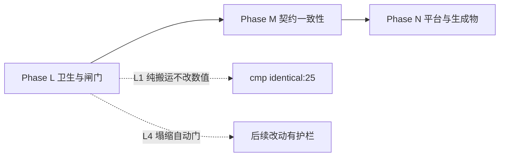

# world1980 · 项目评审与后续迭代路线

> 评审日期：2026-10-17 ｜ 基线提交：`0e82a70` ｜ 本文只做评审与规划，不改动任何代码。
>
> **基线全绿**：`validate_data` ✅ · `validate.test` 65/65 ✅ · 探针 25/25 ✅ · `cmp` identical:25 ✅

---

## 一、结论摘要

项目已处于历史最佳状态。四道护栏（数据契约 / 效果词表 / 存档迁移 / 跨平台探针）齐备，
七大国全部跑通「外部压力 → 内政天平 → 议程门控 → 完成回馈」的闭环，
产物体积已定为「不再优化」的回归护栏（磁盘 `out/` ≤ 3.2 MiB）。

**因此本轮评审不再找"要加什么功能"，而是找"哪些结构债会在下一次加功能时反噬"。**
8 条发现全部来自实测（函数边界、探针注册表、生成物清单、函数归属），分为四类：

- **结构债**（2 条）：纯搬运即可消除，验收标准是 `cmp` 仍 identical；
- **流程债**（2 条）：不同步就静默失效，靠自动门消除；
- **契约债**（2 条）：真正改代码路径，必须逐位核对；
- **生成物与平台债**（2 条）：手写维护的生成物 + PWA 深链取舍。

---

## 二、已交付阶段回顾（A–K）

| 阶段 | 主题 | 关键成果 |
| --- | --- | --- |
| **B** | 架构 | 9108 行单 IIFE → 13 个有序模块；rAF 播放态调度 + 单一 resize 监听 |
| **C** | 存档 | 失败诊断 `{ok,reason,detail}` + 4 槽位 + 导入导出 + 版本迁移表 |
| **D** | 数据层 | `GRD` 悬空修复、`INIT_RESERVES` 30→54、构建期外键 + 效果词表校验、统一 `resolve()` |
| **E** | 玩法 | AI 反应式 → 主动战略目标（22 目标 / 9 国）、CHN/DEU 专属内政、沙盒模式 |
| **F** | 快赢 | 探针接 CI（跨平台运行器 + 基线 + 双 job 绿）；修复 blocprobe/decprobe 两个长期失效探针 |
| **G** | 收尾 | `12-probes.js`（1754 行）→ `app/probes/*` 9 个模块；超长函数清零；调试面收敛为单一 `window.__W1980` |
| **H** | 玩法深度 | AI 目标权重平滑化；CHN/DEU 内政↔经济双向耦合；CHN/DEU 三步议程树 + 内政门控 |
| **I** | 工具链 | 校验器拆成可单测模块 + `--json`/`--report`；效果词表运行期双保险；54 实体覆盖矩阵 |
| **J** | 平台化 | 存档 v2→v3 迁移链；GitHub Pages + PWA（预缓存 87 项）；产物 3.516 → 3.127 MiB |
| **K** | 玩法深度 | JPN/FRA/GBR 专属内政 + 三步议程树；门控统一为数据声明式 `domestic_faction`；删 `has_capital`（−59,827 B） |

### 当前玩法骨架（七大国全覆盖）

| 国家 | 内政天平 | 外部压力来源 | 议程树 |
| --- | --- | --- | --- |
| SUN | 保守鹰派 vs 改革派 | 军费 / 商品短缺 | 合资法 → 新联盟 |
| USA | 国会 vs 总统民调 | 赤字 / 预算帽 | 供给学派 → SDI |
| CHN | 计划派 vs 特区派 | 制裁 / 巴统 / 能源缺口 | 特区 → 裁军 → 市场化 |
| DEU | SPD vs CDU | 油气通道 / 巴统 / 制裁 | 新东方 → 单一市场 → 防务支柱 |
| JPN | 出口产业派 vs 内需开放派 | 技术出口通道 / 原油矿产 / 巴统 | 半导体 → 黑潮 → 前川报告 |
| FRA | 国家干预派 vs 紧缩坚挺派 | 油气输入 / 巴统 / 资本外逃 | 国有化 → 紧缩转向 → 工业重组 |
| GBR | 货币主义派 vs 福利共识派 | 巴统 / 制裁 / 全球金融风险溢价 | 货币主义 → 工会改革 → 大众持股 |

---

## 三、评审发现

> 每条都附实测证据。按**性质**分类，不按主观优先级 —— 「结构债」的验收标准是 `cmp` 仍 identical（纯搬运），
> 「契约债」才会真正改变代码路径，必须逐位核对。

### A. 结构债（纯搬运，验收 = `cmp` identical:25）

| # | 发现 | 实测证据 | 对策 |
| --- | --- | --- | --- |
| **S-1** | `07-domestic.js` 膨胀到 **2451 行**，domestic / agenda / crisis 三区规模相当；下一个议程树会把它推过 2600 行 | 逐行定位函数声明：domestic **29 fn / 1224 行**（第 5–1228），agenda **15 fn / 886 行**（1229–2114），crisis **8 fn / 337 行**（2115–2451） | **L1** crisis 区整段搬到 `app/07a-crisis.js` |
| **S-2** | **函数归属错乱**：① `07-domestic.js` 第 5/37 行的 `refreshLeaderCard` / `refreshOverviewCard` 是**领袖肖像卡与概览卡**（UI），却被 `06-ai.js:906/912`、`11-shell.js:870`、`08-covert.js:1017/1019` 调用；② `08-covert.js`（1074 行）同时承载 **5 个子系统**：intel（5 fn）、afghan（5 fn）、sound（3 fn）、assets probe（1 fn）、panel tabs（1 fn） | `Select-String` 确认四个调用点；`08-covert.js` 函数清单确认五组互不相关的函数 | **L1** 一并搬运：两个 UI 函数移到 `11-shell.js`，sound/assets 探针移到 `probes/` |

### B. 流程债（不同步就静默失效）

| # | 发现 | 实测证据 | 对策 |
| --- | --- | --- | --- |
| **S-3** | 新增探针要同步 **4 处**（`probe_runner.py PROBES`、`13-boot.js` 25 个 `if`、`CR.probeMode` 正则、`09-debug-hook.js`），**不同步就静默失效** —— 历史上 blocprobe/decprobe 就是这么死的 | 探针 URL 参数在 runner 与 `probeMode` 正则里逐字重复；`endprobe` 用 `end=1` 而非 `endprobe=1`，已是不一致先例 | **L2** `PROBE_PARAMS` 常量 + runner 自检 diff |
| **S-4** | 「断言塌缩」检测只在 `cmp` 一层，**全靠人工核对** | 25 个探针共 **637 条命名断言** + 195 个扁平字段；**16 个断言名跨探针重复**（`spectatorZeroPmods` 出现在 6 个探针） | **L4** `probe_runner.py count` + `cmp` 在断言数减少时判失败 |

### C. 契约债（真正改代码路径，需逐位核对）

| # | 发现 | 实测证据 | 对策 |
| --- | --- | --- | --- |
| **S-5** | **议程完成回馈是逐国 if-else**（加一国就要改引擎），且 `effects.js` 的 target 注释已与实现不同步（`stabilityBonus` 仍写 `generals[*].stability`，但七大国已走专属分支） | `updateMonthlyAgendas` 中 `stabilityBonus` 分派为 SUN/USA/CHN/DEU/JPN/FRA/GBR/generals **八路** | **M1** 改为数据声明式 `ag.onComplete` |
| **S-8** | **备份仓 pipeline 与主仓 `out/` 双写**，靠 `robocopy /MIR` 手工同步 | Phase K 需在两侧各改一次 `has_capital`；镜像后 `git status` 出现 8 个待提交文件 | **M2** 二选一：pipeline 为唯一事实源 / 备份仓 CI 加 diff 门 |

### D. 生成物与平台债

| # | 发现 | 实测证据 | 对策 |
| --- | --- | --- | --- |
| **S-6** | `sw.js` 的 `PRECACHE` **87 项手写**维护；而 README 已声称「这两个文件由 `out/` 的文件清单生成」——**实际上仓库里没有任何生成器** | `Select-String` 全仓（排除 `out/`）搜 `PRECACHE`/`precache`/`sw.js` → **0 命中**，即无生成脚本 | **N2** `tools/sw_manifest.js` 自动生成 + CI diff 校验（顺带修正 README 的表述） |
| **S-7** | PWA 在带参深链下**静默失效**（`?player=SUN` 丢掉离线能力，且无提示） | `14-pwa.js`：`bare = q === "" \|\| q === "?"`，带任何参数即不注册 | **N1** 改用 `PROBE_PARAMS` 反向匹配 |

---

## 四、后续路线（Phase L–N）

### Phase L — 卫生与闸门（低风险，0.5–1 天）

> 全部**不改变任何仿真数值**，是后续所有改动的干净地基。

| 项 | 内容 | 验收标准 |
| --- | --- | --- |
| **L1** | 三处纯搬运：① `07-domestic.js` 的 crisis 区（8 fn / 337 行）→ `app/07a-crisis.js`；② `refreshLeaderCard` / `refreshOverviewCard` → `11-shell.js`；③ `08-covert.js` 的 sound / assets 探针 → `probes/`。`index.html` 脚本顺序同步 | **`cmp` 仍 identical:25**（纯搬运的最终判据）；`07-domestic.js` < 1300 行、`08-covert.js` < 850 行（均按物理行计） |
| **L2** | 探针注册收敛：`13-boot.js` 导出 `PROBE_PARAMS` 常量数组，`CR.probeMode` 改为 `some()`；runner 增加「PROBES 键 vs PROBE_PARAMS」自检 | 新增/改名探针只改一处；两者不同步时 runner 报错 |
| **L3** | 清死代码：删引擎里数据侧零引用的 `domestic_reform_lead` / `domestic_detente` 两个 handler；`validate_data.js` 增「未知 condition 判失败」 | 基线 identical；故意写一个未注册 condition 必须让 CI 失败 |
| **L4** | 断言塌缩自动门：`probe_runner.py count` 输出每探针断言数，`cmp` 在断言数**减少**时判失败（增加不算失败） | 删掉一条断言 → `cmp` 必须退出非 0 |

### Phase M — 契约一致性（中风险，1 天）

| 项 | 内容 | 验收标准 |
| --- | --- | --- |
| **M1** | 议程完成回馈数据声明式：`ag.onComplete` 描述内政变量增量，引擎统一求值，删除 8 路 if-else；同步修正 `effects.js` 的 target 注释 | 五条 `*CompletionFeedsDomestic` 断言全绿；基线差异只落在预期字段 |
| **M2** | 备份仓 pipeline 双写收敛：pipeline 为唯一事实源（主仓 `out/` 由它组装）**或** 备份仓 CI 加「pipeline 输出 == out/」diff 门 | 重跑 pipeline 后 `git status` 干净 |

### Phase N — 平台与生成物（低风险，0.5 天）

| 项 | 内容 | 验收标准 |
| --- | --- | --- |
| **N1** | PWA 深链注册修复：判定从「查询串为空」改为「不含探针参数」 | `?player=SUN` 下 `navigator.serviceWorker.controller` 非空；探针下仍不注册 |
| **N2** | `sw.js` 预缓存清单自动生成：`tools/sw_manifest.js` 扫 `out/` 写 `PRECACHE`，CI diff 校验；修正 README 中「已自动生成」的表述 | 新增静态文件后不更新 `sw.js` → CI 失败 |

### 执行顺序的理由



- **L 先行**：拆文件 / 清死代码 / 加闸门都不动仿真数值，风险最低；L4 的塌缩自动门为 M 阶段的引擎改动提供护栏。
- **M 必须等 L**：M1 真正改 `updateMonthlyAgendas` 的分派逻辑，只有在基线护栏加固后才安全。
- **N 可穿插**：纯平台层，风险最低。

---

## 五、约束与不变量（改动前必读）

1. **仿真确定性（最高优先级）**：不得改变 1980–1991 史实路径的逐位数值。改动后重生成 `tools/baseline-probes.json`，确认除时间/画布/平台字段外逐位一致。
2. **存档格式**：`SAVE_VERSION = 3`。结构变更必须走 `SAVE_MIGRATIONS`；新增字段走 `sanitize*` 默认值即可不升版（Phase H/K 已验证）。
3. **效果词表**：新增 `effects` 键必须先进 `data/effects.js`，否则构建期判失败。
4. **探针即契约**：`tools/baseline-probes.json` 是回归基线；差异必须能逐条解释，**绝不能丢失断言**。
5. **发布**：任何发布文件变更都要 bump `out/sw.js` 的 `CACHE_VERSION`。

### 每次改动后的固定动作

```bash
node tools/validate_data.js out
node tools/validate.test.js
python tools/probe_runner.py run out tools/probe-results.json
python tools/probe_runner.py cmp tools/baseline-probes.json tools/probe-results.json
```

四项全绿后再提交；重生成基线前先看清差异。
