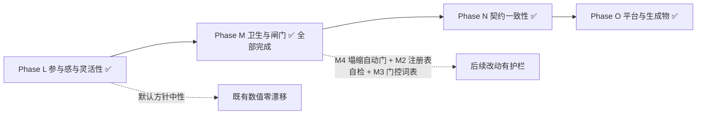

# world1980 · 项目评审与后续迭代路线

> 评审日期：2026-10-17（Phase L 交付于 2026-10-18；M/N/O 交付于 2026-10-19）｜ 基线提交：`0e82a70` 之后连续推进
>
> **基线全绿**：`validate_data` ✅ · `validate.test` 88/88 ✅ · 探针 25/25 ✅ · `cmp` identical:25 ✅
> **断言总数**：861（`probe_runner.py count` 口径，含 190 条扁平探针观测）+ 43 条诊断（Phase L 前为 854 + 39）

---

## 一、结论摘要

项目已处于历史最佳状态。四道护栏（数据契约 / 效果词表 / 存档迁移 / 跨平台探针）齐备，
七大国全部跑通「外部压力 → 内政天平 → 议程门控 → 完成回馈」的闭环，
产物体积已定为「不再优化」的回归护栏（磁盘 `out/` ≤ 3.2 MiB）。

本轮评审分两步：先找出「哪些结构债会在下一次加功能时反噬」（9 条发现），
再针对**参与感与战略灵活性**做了第一轮玩法迭代（Phase L，已交付）。

### 9 条发现（全部来自实测）

- **结构债**（2 条）：纯搬运即可消除，验收标准是 `cmp` 仍 identical；
- **流程债**（2 条）：不同步就静默失效，靠自动门消除；
- **契约债**（3 条）：真正改代码路径或已成死代码，必须逐位核对；
- **生成物与平台债**（2 条）：手写维护的生成物 + PWA 深链取舍。

### Phase L 一句话结论

此前**七大国各有 2 个零代价、可无限点击的内政动作**，而**47/54 个实体一个按钮都没有** ——
"选择"形同虚设。Phase L 用「政治资本（稀缺行动预算）+ 施政方针（自选治理路线）」
把已有系统变成真正的取舍，并让全部 54 个可玩实体都能施政。
**默认方针完全中性，因此 24 个非 domestic 探针逐位不变。**

---

## 二、已交付阶段回顾（A–M）

| 阶段 | 主题 | 关键成果 |
| --- | --- | --- |
| **B** | 架构 | 9108 行单 IIFE → 13 个有序模块；rAF 播放态调度 + 单一 resize 监听 |
| **C** | 存档 | 失败诊断 `{ok,reason,detail}` + 4 槽位 + 导入导出 + 版本迁移表 |
| **D** | 数据层 | `GRD` 悬空修复、`INIT_RESERVES` 30→54、构建期外键 + 效果词表校验、统一 `resolve()` |
| **E** | 玩法 | AI 反应式 → 主动战略目标（22 目标 / 9 国）、CHN/DEU 专属内政、沙盒模式 |
| **F** | 快赢 | 探针接 CI（跨平台运行器 + 基线 + 双 job 绿）；修复 blocprobe/decprobe 两个长期失效探针 |
| **G** | 收尾 | `12-probes.js`（1754 行）→ `app/probes/*` 9 个模块；超长函数清零；调试面收敛为单一 `window.__W1980` |
| **H** | 玩法深度 | AI 目标权重平滑化；CHN/DEU 内政↔经济双向耦合；CHN/DEU 三步议程树 + 内政门控 |
| **I** | 工具链 | 校验器拆成可单测模块 + `--json`/`--report`；效果词表运行期双保险；54 实体覆盖矩阵 |
| **J** | 平台化 | 存档 v2→v3 迁移链；GitHub Pages + PWA（预缓存 87 项）；产物 3.516 → 3.127 MiB |
| **K** | 玩法深度 | JPN/FRA/GBR 专属内政 + 三步议程树；门控统一为数据声明式 `domestic_faction`；删 `has_capital`（−59,827 B） |
| **L** | 参与感与灵活性 | 政治资本行动预算（月度结算、动作扣费、不足即拒绝且零副作用）；47 个通用实体获得 3 条施政路线；施政方针三选一（均衡/强硬/改革）改变成本与漂移；面板预算条 + 成本角标 + 禁用态；国家战略指令板（6 选 2 跨年度目标） |
| **M** | 卫生与闸门 | `07-domestic.js` 2995 → 1279 行（拆成 domestic / agency / agenda / crisis 四模块）；`08-covert.js` 1074 → 845；两个 UI 卡片归位到 `11-shell.js`；新增 `probe_runner.py count` 与**断言塌缩自动门**（丢一条断言即失败）；探针注册收敛为 `data/probes.js`；议程门控词表 `data/agenda-conditions.js` |
| **N** | 契约一致性 | 议程完成回馈改为数据声明式 `onComplete`（删掉 7 国 if-else + 14 段硬编码）；`domesticStateOf` 单一入口；`ONCOMPLETE_FIELDS` 词表 + 校验 + 探针断言；导出结构对账 `tools/check_export_schema.js`（产物 ↔ pipeline 契约，实测能抓 `has_capital` 类漂移） |
| **O** | 平台与生成物 | PWA 注册判定改为「是否探针/诊断会话」——`?player=SUN` 等深链恢复离线能力，探针仍不注册（10 种 URL 实测）；`sw.js` 预缓存清单由 `tools/sw_manifest.js` 生成、两仓 CI 校验 |

### 当前玩法骨架（七大国全覆盖）

| 国家 | 内政天平 | 外部压力来源 | 议程树 |
| --- | --- | --- | --- |
| SUN | 保守鹰派 vs 改革派 | 军费 / 商品短缺 | 合资法 → 新联盟 |
| USA | 国会 vs 总统民调 | 赤字 / 预算帽 | 供给学派 → SDI |
| CHN | 计划派 vs 特区派 | 制裁 / 巴统 / 能源缺口 | 特区 → 裁军 → 市场化 |
| DEU | SPD vs CDU | 油气通道 / 巴统 / 制裁 | 新东方 → 单一市场 → 防务支柱 |
| JPN | 出口产业派 vs 内需开放派 | 技术出口通道 / 原油矿产 / 巴统 | 半导体 → 黑潮 → 前川报告 |
| FRA | 国家干预派 vs 紧缩坚挺派 | 油气输入 / 巴统 / 资本外逃 | 国有化 → 紧缩转向 → 工业重组 |
| GBR | 货币主义派 vs 福利共识派 | 巴统 / 制裁 / 全球金融风险溢价 | 货币主义 → 工会改革 → 大众持股 |

### 玩家可用的战略杠杆（Phase L 之后）

| 杠杆 | 作用 | 代价 / 约束 |
| --- | --- | --- |
| 军费占比滑块 | 直接改写国防投入与阵营网络加成 | 挤压民生、抬高对手张力 |
| 制裁 / 军援（各 2 个目标 × 3 档） | 改写目标国经济与自身反噬 | 逐档自损 |
| 内政施政动作（大国 2 条、通用实体 3 条） | 推动派系天平与关键指标 | **消耗政治资本**（12–20 点/次） |
| 施政方针（均衡 / 强硬 / 改革） | 改变动作成本、动荡漂移、预算结算速率 | 切换 15 点；非均衡路线自带副作用 |
| 国家战略指令（6 选 2，24–36 个月） | 跨年度目标：达标返还预算并记入编年史 | 采纳 10 点；逾期扣预算并抬升动荡 |
| 专属议程（各国 2–3 步树） | 结构性 GDP / 外汇 / 安定加成 | 前置链 + 内政门控 |
| 首脑峰会 / 军控条约 / 安理会决议 | 改写美苏张力与地区秩序 | 需满足可行性与票数 |
| 隐蔽行动 / 阿富汗政策 | 情报、代理人战争与帝国失血 | 暴露风险与资源消耗 |
| 危机抉择卡 | 一次性高风险高回报 | 选项互斥，效果不可逆 |

---

## 三、评审发现

> 每条都附实测证据。按**性质**分类，不按主观优先级 —— 「结构债」的验收标准是 `cmp` 仍 identical（纯搬运），
> 「契约债」才会真正改变代码路径，必须逐位核对。

### A. 结构债（纯搬运，验收 = `cmp` identical:25）

| # | 发现 | 实测证据 | 对策 |
| --- | --- | --- | --- |
| **S-1** | `07-domestic.js` 膨胀到 **2451 行**，domestic / agenda / crisis 三区规模相当；下一个议程树会把它推过 2600 行 | 逐行定位函数声明：domestic **29 fn / 1224 行**（第 5–1228），agenda **15 fn / 886 行**（1229–2114），crisis **8 fn / 337 行**（2115–2451） | **L1** crisis 区整段搬到 `app/07a-crisis.js` |
| **S-2** | **函数归属错乱**：① `07-domestic.js` 第 5/37 行的 `refreshLeaderCard` / `refreshOverviewCard` 是**领袖肖像卡与概览卡**（UI），却被 `06-ai.js:906/912`、`11-shell.js:870`、`08-covert.js:1017/1019` 调用；② `08-covert.js`（1074 行）同时承载 **5 个子系统**：intel（5 fn）、afghan（5 fn）、sound（3 fn）、assets probe（1 fn）、panel tabs（1 fn） | `Select-String` 确认四个调用点；`08-covert.js` 函数清单确认五组互不相关的函数 | **L1** 一并搬运：两个 UI 函数移到 `11-shell.js`，sound/assets 探针移到 `probes/` |

### B. 流程债（不同步就静默失效）

| # | 发现 | 实测证据 | 对策 |
| --- | --- | --- | --- |
| **S-3** | 新增探针要同步 **4 处**（`probe_runner.py PROBES`、`13-boot.js` 25 个 `if`、`CR.probeMode` 正则、`09-debug-hook.js`），**不同步就静默失效** —— 历史上 blocprobe/decprobe 就是这么死的 | 探针 URL 参数在 runner 与 `probeMode` 正则里逐字重复；`endprobe` 用 `end=1` 而非 `endprobe=1`，已是不一致先例 | ~~M2 `PROBE_PARAMS` 常量 + runner 自检 diff~~ → **✅ 已由 M2 解决**：收敛为单一事实源 `data/probes.js`，三处消费 + 三重自检 |
| **S-4** | 「断言塌缩」检测只在 `cmp` 一层，**全靠人工核对** | 25 个探针共 **637 条命名断言** + 195 个扁平字段；**16 个断言名跨探针重复**（`spectatorZeroPmods` 出现在 6 个探针） | **L4** `probe_runner.py count` + `cmp` 在断言数减少时判失败 |

### C. 契约债（真正改代码路径，需逐位核对）

| # | 发现 | 实测证据 | 对策 |
| --- | --- | --- | --- |
| **S-5** | **议程完成回馈是逐国 if-else**（加一国就要改引擎），且 `effects.js` 的 target 注释已与实现不同步（`stabilityBonus` 仍写 `generals[*].stability`，但七大国已走专属分支） | `updateMonthlyAgendas` 中 `stabilityBonus` 分派为 SUN/USA/CHN/DEU/JPN/FRA/GBR/generals **八路** | **M1** 改为数据声明式 `ag.onComplete` |
| **S-6** | 引擎里 `domestic_reform_lead` / `domestic_detente` 两个 handler 在数据侧**零引用**（Phase K 已把 CHN/DEU 改写成 `domestic_faction`），已成死代码；而「数据用了未注册 condition」目前不会让 CI 失败 | 数据侧 condition 全集 = `{mil_le_1, mil_le_3, mil_ge_5, domestic_faction}` | ~~删两个 handler +「未知 condition 判 CI 失败」~~ → **✅ 已由 M3 解决**：分支已删，词表 `data/agenda-conditions.js` 让未登记名字在构建期失败、运行期 fail-closed |
| **S-7** | **备份仓 pipeline 与主仓 `out/` 双写**，靠 `robocopy /MIR` 手工同步 | Phase K 需在两侧各改一次 `has_capital`；镜像后 `git status` 出现 8 个待提交文件 | **M2** 二选一：pipeline 为唯一事实源 / 备份仓 CI 加 diff 门 |

### D. 生成物与平台债

| # | 发现 | 实测证据 | 对策 |
| --- | --- | --- | --- |
| **S-8** | `sw.js` 的 `PRECACHE` **87 项手写**维护；而 README 已声称「这两个文件由 `out/` 的文件清单生成」——**实际上仓库里没有任何生成器** | `Select-String` 全仓（排除 `out/`）搜 `PRECACHE`/`precache`/`sw.js` → **0 命中**，即无生成脚本 ~~N2 `tools/sw_manifest.js` 自动生成 + CI diff 校验~~ → **✅ 已由 O2 解决**（清单为生成物，两仓 CI 校验） |
| **S-9** | PWA 在带参深链下**静默失效**（`?player=SUN` 丢掉离线能力，且无提示） | `14-pwa.js`：`bare = q === "" \|\| q === "?"`，带任何参数即不注册 ~~N1 改用 `PROBE_PARAMS` 反向匹配~~ → **✅ 已由 O1 解决**（改判「是否探针会话」，10 种 URL 实测） |

---

## 四、后续路线（Phase L–O）
### Phase L — 参与感与战略灵活性（✅ 已交付）
> 目标：让「选择」真的成为选择。此前七大国各有 2 个内政动作且**零代价、可无限点击**，
> 47/54 个实体（所有非大国）面板里**一个可点的按钮都没有** —— 这是可玩性与参与感的最大缺口。
> 本轮不新增数值系统，而是给已有系统加一层「稀缺性 + 自主路线」。
> **对既有仿真数值零影响**：预算与方针只约束玩家动作，不写 `P.pmods`；默认方针完全中性。

| 项 | 内容 | 验收标准（已达成） |
| --- | --- | --- |
| **L1 政治资本** | 玩家专属行动预算：每月按「执政合法性 / 社会动荡」结算（基准 +3.0，区间 [-1.5, +6.0]），上限 100。合法性取自各国最能代表施政授权的指标（SUN 用政治局天平撕裂度+短缺、USA 用国会支持率、CHN 用改革派差值+双轨物价、DEU 用缓和深度+能源压力、JPN 用贸易摩擦、FRA 用法郎平价+外部压力、GBR 用金融城+通胀、通用实体用合法性） | 19 条断言：结构/结算方向/夹取/月度推进/扣费精确性/**不足时零副作用**/成本表/存档往返/旧档缺省 |
| **L2 通用施政** | 47 个此前零按钮的实体获得 3 条互斥路线：财政紧缩（合法性↑民生↓动荡↑）、扩大福利（安定↑动荡↓合法性↓）、强化治安（动荡↓↓合法性↓↓）。全部消耗同一份政治资本 | 面板渲染 3 按钮 + 三条路线各自的代价方向断言 |
| **L3 施政方针** | 玩家自选治理路线：⚖️ 均衡（默认，零漂移零折扣）/ 🛡️ 强硬（压制动荡、强硬类动作 -20~30% 成本，但结算 -0.8/月）/ 🌱 改革（开放福利类动作 -15~20% 成本、结算 +1.0/月，但每月抬升动荡）。切换消耗 15 点 | 16 条断言：默认中性/切换扣费/不足拒绝/重复选择无操作/两侧成本折扣/结算方向/**动荡漂移差分比较**/面板高亮/存档往返 |
| **L4 UI** | 执政国面板顶部统一插入政治资本预算条（含月度结算率）、动作按钮成本角标 `-N`、预算不足时按钮禁用且后端同样拒绝；方针三按钮带高亮与说明 | CDP 真浏览器 9 步检查全 PASS（含点击真实按钮、禁用态、差分漂移、指令板、存档往返、确定性） |
| **L5 战略指令** | 玩家自选**长周期目标**（6 选 2）：社会和解 / 民意授权 / 储备积累 / 战略落地 / 军费收缩 / 军备扩张。采纳消耗 10 点，达标返还 18–25 点并记入编年史，逾期未达标则扣预算并抬升动荡。指标全部读既有状态（动荡/合法性/军费/外汇/议程数），不新增任何经济通道 | 15 条断言：初始为空/旧档缺省/采纳扣费/重复拒绝/上限 2 项/预算不足拒绝/进度计算/达标返还/已完成不可再采纳/逾期惩罚/面板渲染/存档往返 |

**关键设计约束（务必保持）**：默认方针 `balanced` 的 `costMod = {}`、`unrestDrift = 0`、`capitalMod = 0`，
因此 AI 与史实路径完全不受影响 —— 这也是本轮 24 个非 domestic 探针逐位不变的根因。

**面板占用实测**（新增 UI 不能把侧栏撑爆）：SUN 419px / CHN 470px / ITA 436px，
无横向溢出；三国均正确渲染 3 个方针按钮与 6 个指令候选。这是「可玩性」不只是「功能存在」的验收线。

### Phase M — 卫生与闸门（✅ 全部完成：M1 + M2 + M3 + M4）

> 目标：把最大的单文件拆成按域的内聚模块，并给「断言塌缩」加一道自动门。
> **本轮改动对仿真数值零影响** —— 验收标准就是 `cmp` 仍 `identical:25`。

**M1 — 拆 `07-domestic.js`（2995 → 1273 行，−57%）**

纯搬运，逐行切分、零逻辑改动。按域拆成四个模块 + 三个探针模块：

| 新文件 | 行数 | 内容 |
| --- | --- | --- |
| `app/07-domestic.js` | 1273 | 内政核心：状态初始化/清洗、七国月度推进器、外部压力评估、施政动作、八套面板构建器 |
| `app/07a-agency.js` | 398 | Phase L 玩家能动性层：政治资本、施政方针、国家战略指令 |
| `app/07b-agenda.js` | 469 | 国家议程核心：状态、加成结算、门控求值、月度推进、面板 |
| `app/07c-crisis.js` | 234 | 危机抉择卡：状态、弹窗、结算、月度触发 |
| `app/probes/08a-agenda.js` | 418 | 议程全链路探针（7 个函数） |
| `app/probes/08b-crisis.js` | 108 | 危机探针 |
| `app/probes/08c-sound-assets.js` | 231 | 音效与美术资源探针（原在 `08-covert.js`） |

另两处搬运：
- `refreshLeaderCard` / `refreshOverviewCard`（领袖肖像卡与概览卡）从 domestic 文件头部移到 `app/11-shell.js` ——
  它们是被 `06-ai` / `11-shell` / `08-covert` 调用的 UI，此前错放在内政模块。
- `08-covert.js` 的音效/资源探针移出后由 **1074 → 845 行**，回到「谍战 + 阿富汗」两个内聚子系统。

**M4 — 断言塌缩自动门**

`probe_runner.py` 新增 `count` 子命令与 `cmp` 的塌缩判定：
- `count <results.json> [--json]`：输出每个探针的断言条数与总数（当前 25 探针 / **854 条**）。
- `cmp` 在任一探针断言数**减少**时退出 2，并打印塌缩的探针、前后条数与**丢失的断言名**：

```
ASSERTION COLLAPSE (1 probe(s)):
  domestic: 116 -> 115 assertions
  total: 854 -> 853
  lost: domestic/initDomesticStateExists
```

断言**增加**不算失败。CI 增加一个 `count` 步骤（把覆盖表打进日志），`cmp` 步骤自动获得塌缩门。

**验收（已达成）**：`cmp` 仍 `identical:25`；`07-domestic.js` 1273 < 1500；`08-covert.js` 845 < 850；
146 个函数与 13 个顶层声明**全部保留且无重复**；CDP 真浏览器 9 步面板检查全 PASS；
故意删掉一条断言 → `cmp` 必须退出 2（已实测）。

**踩到的坑（值得记住）**：`probes/09-debug-hook.js` 在**加载时**就用对象字面量求值
`runSoundProbe` / `runAssetsProbe` / `runAgendaProbe` / `runCrisisProbe` / `refreshLeaderCard`，
所以这些函数所在的脚本必须排在它**之前**。第一次拆分把音效探针排在 debug-hook 之后 →
`selftest` 立刻报 `runSoundProbe is not defined`。`cmp` 一眼抓住，改名到 `08c-` 前缀后恢复 identical。

**M2 — 探针注册收敛**

此前「加一个探针」要同步四处，任一处不同步就静默失效（blocprobe / decprobe 就是这么死的）：
runner 的 `PROBES` 字典、`13-boot.js` 的 20 个 `if`、`CR.probeMode` 的正则、`09-debug-hook.js` 的导出。

现在只有一个事实源 **`out/data/probes.js`**：

```js
window.W1980_PROBES = { params: [...], entries: { key: { qs, marker, budget } } };
```

| 消费者 | 用法 |
| --- | --- |
| `app/10-events-save.js` | `CR.probeMode = hasProbeParam(probeParamTokens(), location.search)` |
| `app/13-boot.js` | 18 个普通探针改为 `PROBE_RUNNERS` 分派表（令牌 → 函数）遍历；启动时 `assertProbeDispatchConsistency()` 自检 |
| `tools/probe_runner.py` | 删除硬编码 `PROBES`，改读同一份 `entries`；`load_registry()` 做内部自洽校验 |
| `tools/validate/checks.js` | 新增 `checkProbeRegistry`（CI 每次跑） |
| `data/sound.js` | `isProbeOrHeadless` 的 20 项重复正则改为读注册表（`audit` 单独保留） |

**三重自检**，每一重都被实测触发过：

1. **校验器**（CI）：params 与 entries 必须描述同一组探针、参数令牌唯一、marker 唯一、budget 为正
   → 新增 10 条单测（65 → **75** 条）。
2. **运行器**（启动前）：删掉 `params` 里的 `domesticprobe` →
   `PROBE REGISTRY INVALID (data/probes.js): registry.entries has probes missing from params: domesticprobe`，退出 2。
3. **浏览器**（启动时）：`assertProbeDispatchConsistency({ghostprobe:1})` →
   `探针分派表里的 ghostprobe 未在 data/probes.js 的 params 中登记`（抛错 → 启动错误面板）。

**关键细节**：`params` 是**参数令牌**不是探针键 —— `?end=1` 的令牌是 `end`（键是 `endprobe`），
`?bloc=WP` 的令牌是 `bloc`（键是 `blocprobe`）。匹配必须整词（`[?&]token(=|&|$)`），
否则 `?endTab=3` 会误命中 `end`。CDP 实测：25 个令牌全部置位、`?endprobe=1` 不命中、`?endTab=3` 不命中。

**验收（已达成）**：`cmp` 仍 `identical:25`；断言总数仍 854（未增未减）；`validate.test` 65 → 75；
`validate_data` 多一行 `probe registry: 25 probes, 25 url params, 0 problem(s)`；
CDP 注册表专项检查 4 组全 PASS；`sw.js` → `w1980-v11`，PRECACHE 93 → 94 项且与实际文件数一致。

**M3 — 清死代码 + 门控词表**

两件事：删掉零引用的引擎分支，并把「门控名字」变成有契约的词汇表。

1. **删死代码**：`checkAgendaCondition` 里的 `domestic_reform_lead` / `domestic_detente` 两个分支
   在 Phase K 之后数据侧零引用（CHN/DEU 已改用 `domestic_faction`），直接删除。
2. **门控词表**：新增 `out/data/agenda-conditions.js` 作为**单一事实源**：

```js
window.W1980_AGENDA_CONDITIONS = {
  CONDITIONS: { mil_le_3: {...}, mil_le_1: {...}, mil_ge_5: {...}, domestic_faction: {...} },
  isRegistered(name), names(), get(name)
};
```

3. **两个方向都堵住**：
   - **构建期**：`checkAgendaConditions` 校验每个议程的 `condition` 必须是登记值，且
     `domestic_faction` 必须带完整 `faction`（`key` + `lead`/`over` 或 `field`/`min`）。
     注入 `condition: "mil_le_9"` → `FAIL: agendas.js: JPN/jpn_defense_cap 使用了未注册的门控 "mil_le_9"（合法值：…）`，退出 1。
   - **运行期**：引擎遇到未登记的名字**一律判未通过**（fail-closed），并说明
     `未注册的议程门控『X』（见 data/agenda-conditions.js）` —— 一个无法求值的条件绝不能默认放行。
4. **探针**：`agendaProbeConditionVocabulary` 新增 4 条断言 —— 词表 API 存在、数据里用到的门控
   全部已登记、未登记名字被拦下、两个已删的旧名字既不在词表也求值不通过。

**验收（已达成）**：`cmp` 除 `agenda` 外 24 个探针逐位一致；`agenda` 从 70 → **74** 条断言，
**零丢失**（脚本核对 lost = none），新增 2 条诊断；`validate.test` 75 → **85**；
`validate_data` 多一行 `agenda conditions: 4 registered, 11 agenda sites, 0 problem(s)`；
注入未注册门控实测让 CI 失败；`sw.js` → `w1980-v12`，PRECACHE 94 → 95 项。

### Phase N — 契约一致性（✅ 已交付 N1 + N2）

**N1 — 议程完成回馈改为数据声明式**

此前 `updateMonthlyAgendas` 的完成回馈是 **7 国 if-else + 14 段按议程 id 的硬编码**（约 90 行）：
加一个国家的议程树就必须回来改引擎。

现在是两层：

| 层次 | 机制 |
| --- | --- |
| 通用规则 | 按「本国状态里有没有这个字段」分派：`domesticShortage` → `shortage`（苏联）；`stabilityBonus` → 专属内政压 `unrest`、通用实体抬 `stability`；`congressBonus` → `congressApproval`（美国） |
| 议程专属 | `agendas.js` 里 `onComplete: {字段: 增量}`，引擎不认任何国家名或议程 id |

配套：
- 新增 `domesticStateOf(cKey)` —— 「国家键 → 内政状态对象」的唯一入口，取代散落的 8 处国家清单；
- `data/agenda-conditions.js` 新增 `ONCOMPLETE_FIELDS`（30 个合法字段）与 `isOnCompleteField`；
- 校验器 `checkAgendaConditions` 扩展：`onComplete` 字段必须已登记、增量必须是有限数字；
- 探针 `agendaProbeConditionVocabulary` 扩 3 条断言：字段全部已登记、每个字段都能在该国内政状态上解析、
  **原硬编码的 14 项全部改为数据声明**（迁移完整性）；
- 修正 `effects.js` 里 `stabilityBonus` / `congressBonus` 的 target 注释（已与实现不同步）。

**验收**：`cmp` 除 `agenda` 外 24 个探针**逐位一致**（证明重构等价）；`agenda` 74 → **77** 条断言、
零丢失；`validate.test` 85 → **88**；`validate_data` 新增 `14 onComplete sites`。

**N2 — 导出结构对账**

`out/data/provinces.js` / `countries.js` 由备份仓 `pipeline/` 生成，两侧靠人工同步（Phase K 删
`has_capital` 时就得两边各改一次）。完整重跑 pipeline 需要 `work/` 里十几 GB 原始栅格，CI 做不到，
所以新增 `tools/check_export_schema.js` 守可验证的那一半：

1. 产物字段集 == `pipeline/export-schema.json`（结构契约，提交在备份仓）；
2. `pipeline/s5_meta.py` 的 `pj.append({...})` / `t.update({...})` 仍在写这些字段；
3. 省份字段集必须**逐省一致**（任何单省漂移立即失败）；
4. 省份数 / 实体数变化也算违约。

**实测两种漂移都会失败**：
- pipeline 重新写 `has_capital` → `x s5_meta.py 新写了产物里没有的省份字段：has_capital（需要重跑 pipeline 并更新契约）`；
- 产物里少一个字段 → `FAIL: provinces.js 中 2997 个省份字段集不一致（例如 id=3）`。

主仓没有 `pipeline/`，此步打印 `SKIP` 并 exit 0；备份仓 CI 才真正对账（两边 CI 都加了这一步）。

**验收**：`node tools/check_export_schema.js out` → `OK: export schema matches the pipeline contract`
（2998 省份 × 8 字段、54 实体 19 字段并集）。

### Phase O — 平台与生成物（✅ 已交付 O1 + O2）

**O1 — PWA 深链注册修复**

开关从「查询串是否为空」改成「是不是探针/诊断会话」：

| URL | 注册 SW | 说明 |
| --- | --- | --- |
| 裸地址 | ✅ | 常规入口 |
| `?player=SUN` / `?c=CHN` / `?m=pop` | ✅ | 普通深链（此前被误判成探针而丢掉离线） |
| `?sw=1` / `?nosw=1` | ✅ / ❌ | 显式强制开 / 关 |
| 任何已登记探针参数（`?domesticprobe=1`、`?end=1&t=…` …） | ❌ | 探针必须走纯网络路径 |
| `dev` / `audit` / `modeprobe` | ❌ | 诊断开关：查问题时命中旧缓存只会更难查 |

判定依据是 `data/probes.js` 的 `params`（与运行器、`CR.probeMode` 同一份事实源），
所以**新增探针自动获得这条保护**，不需要再改 PWA 代码。

**验收**：`files/cdp_pwa.js` 在真浏览器里逐 URL 起独立 profile 验证 **10 种情形全部符合预期**
（4 种深链注册、4 种探针不注册、强制开关各一、诊断开关一）；探针仍 `cmp identical:25`
—— 说明「不注册」这条硬约束没有被放松。

**O2 — `sw.js` 预缓存清单改为生成物**

原先是 95 行手写清单，与 `out/` 实际文件集靠人工核对。新增：
- `tools/sw_manifest.js`（默认校验，`--update` 重写，`--json` 机读）；
- 排除项只有三个且写明理由：`sw.js`（自身）、`serve.py`（本地开发服务器）、`打开地图.bat`（Windows 启动器）；
- 两个仓库的 CI 都加了 `node tools/sw_manifest.js out`。

**实测两种漂移都会失败**：新增一个文件 → `磁盘上有但清单里没有（离线会 404）：+ assets/ui/__probe_new_asset.txt`；
删除文件 → `清单里有但磁盘上已不存在：- …`。`--update` 往返后文件与原始 `sw.js` **逐字节相同**（幂等）。

`CACHE_VERSION` 刻意留在脚本职责之外：清单只反映文件**集合**，内容变更改不出来，
所以仍需手动 bump —— 版本号是人的判断，不是文件列表的副产品。

### 相关发现状态

| 发现 | 状态 |
| --- | --- |
| S-8 `sw.js` 预缓存手写 | ✅ O2 解决 |
| S-9 PWA 深链静默失效 | ✅ O1 解决 |

### 执行顺序的理由



- **L 已完成**：新增了玩家行动预算与治理路线。
- **M 全部完成（M1–M4）**：
  - M1 单文件 2995 → 1279 行，`cmp` 仍 `identical:25` —— 纯搬运的最终判据达成；
  - M2 探针注册收敛为 `data/probes.js`，三处消费者 + 三重自检；
  - M3 删掉两个零引用门控分支，门控名字收敛为 `data/agenda-conditions.js`，未登记即构建期失败、运行期 fail-closed；
  - M4 断言塌缩自动门上线并被实测证明会失败。
- **N 已完成**：N1 把议程完成回馈从「7 国 if-else + 14 段硬编码」变成数据声明式 `onComplete`，
  引擎不再认任何国家名或议程 id；N2 给「产物 ↔ pipeline」加了结构对账门，
  实测能抓到 `has_capital` 那类漂移。
- **O 已完成**：PWA 深链恢复离线能力（探针仍不注册，10 种 URL 实测）；`sw.js` 预缓存清单变成生成物，
  两仓 CI 校验，实测新增/删除文件都会失败。

**L / M / N / O 四个阶段全部交付完毕。**

---

## 五、约束与不变量（改动前必读）

1. **仿真确定性（最高优先级）**：不得改变 1980–1991 史实路径的逐位数值。改动后重生成 `tools/baseline-probes.json`，确认除时间/画布/平台字段外逐位一致。
2. **存档格式**：`SAVE_VERSION = 3`。结构变更必须走 `SAVE_MIGRATIONS`；新增字段走 `sanitize*` 默认值即可不升版（Phase H/K 已验证）。
3. **效果词表**：新增 `effects` 键必须先进 `data/effects.js`，否则构建期判失败。
4. **探针即契约**：`tools/baseline-probes.json` 是回归基线；差异必须能逐条解释，**绝不能丢失断言**。
5. **发布**：任何发布文件变更都要 bump `out/sw.js` 的 `CACHE_VERSION`。

### 每次改动后的固定动作

```bash
node tools/validate_data.js out
node tools/validate.test.js
python tools/probe_runner.py run out tools/probe-results.json
python tools/probe_runner.py cmp tools/baseline-probes.json tools/probe-results.json
```

四项全绿后再提交；重生成基线前先看清差异。
